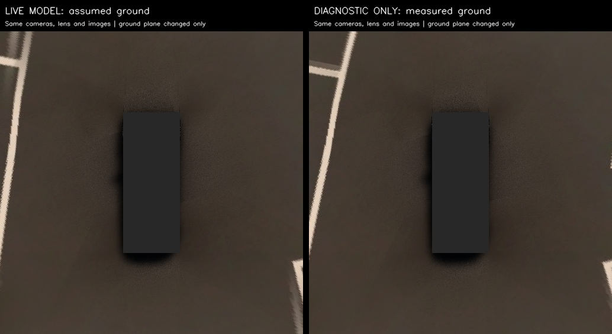

# 2026-11-12 SVM 작업 마감·팀 인수인계

사용자 요청에 따라 현재까지의 구현과 원인 분석을 공유하고, 남은 개발은 기존 담당자가 이어간다. **자동 지면 추정을 프로젝트 필수 구성으로 확정하지 않는다. 평탄한 구역의 정차 영상에서 고정 지면 SVM을 먼저 검증한 뒤, 경사·차체 자세 변화에 필요한 보정을 판단한다.**

## 현재 상태

- 코드: ego TF 변환 수정, 공유 렌즈 v2, 실험적 영상 지면 추정·상태 표시, 입력 중단 처리와 재생 검사가 반영됐다. 프로필은 `261112_kcity_ego_ground_v2`다. 영상 지면 추정은 현재 YAML에서 활성화돼 있지만 필수 아키텍처로 확정한 것은 아니다.
- 검증: 코드 변경 때 테스트97개·CI 통과. 실제 MORAI 9090 연결 후 카메라4개1280×960·약10Hz, Ego/TF 약44.75Hz, SVM 약8.84Hz를 확인했다. [라이브 결과](261112-svm-live.md).
- 한계: 가장자리 정합과 경사면 fallback은 미완료이며, SS-PSD용 clean BEV·검출 노드도 아직 없다. 실제 자율주차 정확도나 성공률을 검증한 상태가 아니다.
- 실행: [commands.md](../commands.md#svm)의 bridge → MORAI Connect·Play → SVM → rqt 순서를 따른다. 이미 실행 중인 노드와 같은 이름으로 중복 실행하지 않는다. 작업 마감 시 bridge·SVM·rqt는 유지했다.

## 이번에 확인한 원인

현재 캡처 위치는 앞선 라이브 검사와 다른 map (−134.782, −468.608), heading72.11°다. 실제 상태는 `pose compensated`이지만 `GROUND ASSUMED`: 유효 지면 대응점을 얻지 못해 map 수평면·고정 차고 가정으로 돌아갔다. 설치 맵의 해당 주차선3D메시로 측정한 지면은 약1.19° 경사였고, base_link 전방5m에서 가정 지면과 높이가 약11.56cm 달랐다.

같은 원본 영상과 대응점으로 항목만 바꾼 **진단 실험**이다. 아래 값은 주차선 법선 방향 차이 중앙값이며, 2D 주차 목표 정확도가 아니다.

| 진단 조건 | 전방–좌측55쌍 | 후방–우측14쌍 |
|---|---:|---:|
| 현재 설정 | 38.5cm | 21.5cm |
| 지면만 측정값 | 4.2cm | 20.5cm |
| 측정 지면 + 초기 렌즈 K/D | 9.1cm | 10.8cm |

전방–좌측은 지면 오류의 영향이 컸다. 후방–우측은 현재 공유 렌즈값이 오차를 키운 부분이 있다. 렌즈·외부 파라미터·경계 오대응의 비중을 한 위치에서 모두 분리한 결과는 아니다. 이번 후방 외곽 관측에서는 원본1px 차이가 지면 좌표 약6cm로 확대됐다. 차량이 정차한 이 장면은 시차 보정을 제거해도 결과가 거의 같아 통신 지연이 주원인은 아니었다.

자동 대응점은 상관된 표본이며 오대응 가능성이 있다. 맵 메시와 측정 지면은 오프라인 원인 분석에만 사용했고 실행 인지 입력으로 추가하지 않았다. 지면 모델·렌즈를 이번 한 장면에 다시 맞춰 배포하지 않았다. [상세 수치·입력 해시](evidence/261112-svm-edge-cause.json).

## 다음 작업과 담당

| 담당 | 이어갈 일 | 남길 결과 |
|---|---|---|
| 하수영 | 평탄한 정차 구역에서 카메라·고정 지면 변환 검증 → 다른 위치/방향 대조 → 경사면 fallback과 필요 보정 판단 → clean BEV·SS-PSD 연결 | 동일 원본의 보정 전후, 카메라별/겹침부 오차, 실패 장면, 설정 버전 |
| 김동현 | 카메라4개·ego TF·상태를 함께 수집하고 동기화·재생 검증. 아래 LiDAR 후보 채택 시 토픽/TF/수집 계약 확인 | 재현 가능한 bag·수집 메타데이터·수신률, 연결 미검증 사항 |
| 안승현 | 센서 정본 관리, 평탄 구역·차고/좌표 기준 확인, 필요 원본 전달과 질의 대응 | 채택한 센서 버전, 비교 조건과 공통 결정 |
| 강도균 | 기존 계획대로 제공 주차칸 GT로 경로·추종 개발 | 인지와 연결할 목표 좌표 계약 및 주차 결과 |
| 장원태 | 작업 노트·증거를 발표자료에 반영 | 구현/진단/미완료 범위를 구분한 그림·수치 |

평탄 구역의 기본 모델을 먼저 확인하고, 경사면에서 차체 기울기와 지면 기울기를 구분한다. `POSE USED`는 자세를 적용했다는 뜻이지 지면 정확도 합격 표시가 아니다. 자동 지면 추정의 점수 조건만 느슨하게 하거나 합성 경계를 흐리게 해서 좌표 오차가 해결됐다고 판단하지 않는다. 후속 변경은 다른 위치에서 악화 여부까지 비교하고 [작업 노트](README.md)에 결과를 남긴다.

## 추가된 센서 export

사용자가 작업트리에 둔 [261112 센서 export](../../config/morai/261112_VIP3_Sensor_26.R1.H3.json)를 검토용으로 함께 보관한다. 261110 정본과 카메라4개의 설정은 동일하며 LiDAR1개만 추가됐다: ID5, 위치(0.8,0,1.45)m, ROS9090 `/lidar3D`, frame `Lidar3D-5`, 설정 주기약0.1초다.

**현재 실행 정본은 261110 카메라 전용 프리셋이다.** 새 export의 LiDAR 수신·TF·데이터 수집·지면 추정 연결은 이번 작업에서 검증하지 않았고 `topics.yaml`/SVM/기본 수집 계약에도 등록하지 않았다. LiDAR 도입 확정을 의미하지 않는다. 채택할 때는 안승현·김동현이 관련 계약과 검사 도구를 함께 갱신하고, 대체된 정본은 Git 이력으로 정리한다. [설정 구분](../../config/README.md).

## 원본과 공유 위치

위 작은 표·JSON·대표 이미지는 팀 Git에 공유했다. 원본 영상/TF·상세 분석은 **안승현 로컬 보유, 대량 원본은 아직 별도 공유 전**이다.

- 캡처: 저장소 밖 `../data/sensor_checks/261112_edge_diagnosis_01/`.
- 분석: `../docs/experiments/261112-svm-edge-diagnosis/README.md`, `analyze.py`; 입력 준비는 기존 로컬 `261112-svm-live-seams/capture.py`, `measure.py`.
- 이전 다중 위치 재보정: `../data/sensor_checks/261112_recalibration/`.

기존 분석은 설치 맵 메시와 로컬 원본을 요구하므로 팀 clone만으로 재실행된다고 가정하지 않는다. 담당자는 원본을 전달받거나 동일 절차로 새 bag을 수집한다. 실행 명령은 [commands.md](../commands.md#collection), 파트별 오너십은 [team.md](../project/team.md)가 기준이다.
