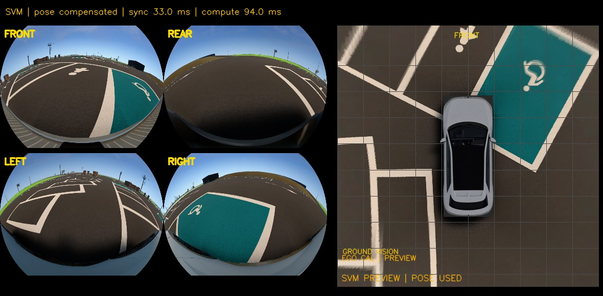

# 2026-11-12 저녁 SVM 라이브 확인

오전 [재보정 기록](261112-svm-calibration.md)의 재연결 대기 후속 검사다. 사용자가 MORAI 카메라·Network ROS를 9090에 다시 연결했다. 코드 `64e2702`, 프로필 `261112_kcity_ego_ground_v2` 그대로 검사했으며 이번에는 보정값과 차량 위치를 바꾸지 않았다.

## 확인 결과

| 항목 | 두 번째 25초 관측 |
|---|---|
| 카메라 4개 | 모두 1280×960, 9.98~10.01Hz |
| Ego / TF | 약 44.75Hz |
| SVM panel | 8.84Hz |
| 유효 입력·자세 보정·영상 지면 | 상태 222개 중 220개 |
| 제외 상태 | 처리 중 입력 만료 2개 |
| 처리 시간 | 중앙값 89.7ms / P95 123.1ms |
| 로컬 수신→publish | 중앙값 189.9ms / P95 329.9ms |

처음 25초에는 유효 223/228, 영상 지면 213/228이었다. 동기화 실패 4개와 처리 중 입력 만료 1개가 있었으며, 원인을 단정하지 않았다. 이어 다른 오프라인 분석을 끝내고 rqt를 띄운 상태로 위 관측을 추가했다. 두 구간 모두 정차 상태이며 장시간·주행 부하 검사는 아니다. 수신→publish에는 MORAI 렌더링, 수신 전 통신, GUI 표시가 포함되지 않는다.

라이브에서는 미세하게 변하는 TF 때문에 두 번째 구간의 유효 220프레임 모두 투영표를 다시 만들었다. 따라서 오전 저장 영상 재생의 26.2ms를 현재 라이브 처리 시간으로 인용하면 안 된다. map 갱신 중앙값은 59.7ms이며 1Hz 지면 추정 비용도 총 처리 시간에 포함됐다.

`EGO CAL | PREVIEW`, `POSE USED`, `GROUND VISION`으로 새 프로필과 자세·지면 보정 적용을 확인했다. **왼쪽 아래 주차선과 장애인 표식에 겹침 오차가 남아 있다.** 연결과 보정 적용을 확인한 것이며, 캘리브레이션 정확도 합격이나 자율주차 성공 검증은 아니다. 이번 장면은 오전 캡처와 가까운 위치라 새 위치에 대한 독립 최종 평가로 쓰지 않는다.

## 자료와 재현

[수치·입력 해시·범위](evidence/261112-svm-live.json). 원본과 상세 시계열은 안승현 로컬 `../data/sensor_checks/261112_recalibration/live_validation_01`, `live_validation_02`, 원본 카메라·TF 묶음은 `../data/sensor_checks/261112_reconnected_01`에 보유한다. 분석 스크립트는 로컬 `../docs/experiments/261112-svm-recalibration/live_monitor.py`다.

기존 `live_v2` 폴더는 연결 직후 카메라만 먼저 들어온 첫 저장본이라 `POSE STATIC / GROUND ASSUMED`다. 이후 정상 상태의 대표 화면은 위 이미지다. `capture.py`가 별도 저장한 `svm_projection.png`는 가정 지면 재구성이고, 실제 라이브 영상 지면 상태는 `runtime-panel.jpg`와 `runtime.json`을 기준으로 확인한다.

현재 bridge·SVM·rqt 창을 유지했다. 실행 명령은 [commands.md](../commands.md#svm-calibration) 그대로다. 팀 확인: 안승현·하수영은 다른 정차 방향과 위치의 잔여 정합 및 처리 지연을 확인하고, 장원태는 위 한계를 포함해 발표에 사용한다.
