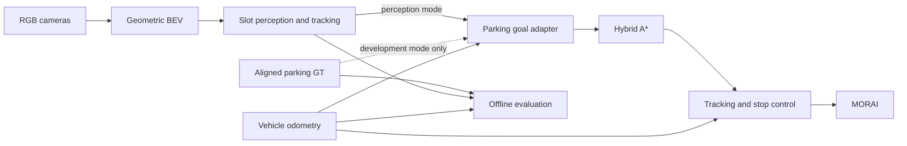

# 센서 기반 자율주차 5주 계획 — 최근 논문 선정과 5개 슬롯 평가

> **문서 역할:** 제안 — 센서 구성·주차칸 인지·경로계획·제어, 팀 전체 75인시·개발자 가용 45인시
> **담당:** 팀 공동 검토용 — 기존 담당을 참고한 역할 제안
> **최종 수정:** 2026-11-10

**현재 실행 계획:** 사용자 확정 역할과 11월 10일 이후 통합 순서는 [roadmap.md](roadmap.md)를 우선한다. 안승현은 센서 확정·총괄, 장원태는 발표·공동 관리·질의응답을 맡는다. 5주·75인시는 전체 팀 예산이며 세 개발자의 가용 시간은 45인시다. 기존 공지의 12/06 기능 동결이 유효하면 약 4주·팀 전체 60인시, 개발자 가용 36인시로 줄어든다. 통합·라벨링·기록도 개발자 시간 안에 포함한다.

최종 목표는 **직접 구성한 카메라 센서로 주차칸을 인지하고, 인지 결과로 경로를 생성해 주차하는 시스템**이다. MORAI 제공 `parking_space_set.json`은 **인지 평가 정답과 인지 개발 전 제어팀의 임시 목표 공급원**으로 사용한다. GT로만 주차한 결과는 개발 중간 결과이며 최종 인지 기반 주차 성공으로 집계하지 않는다. 앞선 문서의 GT 기반 최종 목표와 인지 제외 방침은 이 문서로 수정한다.

권장 구성은 **새로 설계한 주변 카메라 SVM → 방향 키포인트·슬롯 인지 → 목표 자세 → Hybrid A* → Pure Pursuit·저속 정지 제어**다. 주논문 핵심 적용과 비교 실험은 인지 부분에 집중한다. 총 **5명 × 주 3시간 × 5주 = 75인시**이므로, 모든 파트에 새 알고리즘을 구현하거나 여러 인지 모델을 모두 학습하는 계획은 잡지 않는다. 초기 필수 데모는 일반 주차칸 한 곳의 전방주차이며, 다섯 칸은 인지 평가와 확장 검증에 활용한다.

사용자 결정에 따라 **SS-PSD(T-ITS 2025)를 주 기준선**으로 확정했다. **공개 가중치와 직접 수집·라벨링한 MORAI 데이터로 추가 학습한 모델**을 필수 비교로 둔다. DMPR-PS(2019)는 비교·참고용이다. 센서·SVM은 AVM-SLAM의 AVM 전처리 구조, 입력은 SS-PSD의 10×10m·512×512를 따른다. 상세 실행 준비는 [SS-PSD 센서·BEV 설계](ss-psd-sensor-bev-baseline.md)에 정리했다. 기존 센서셋과 v2 프리셋은 검증되지 않은 후보이며 그대로 최종안으로 사용하지 않는다.

## 1. 사용자 선정 후보: 002·008·009·012·039

사용자가 시뮬레이터와 대조한 후보를 원본 JSON에서 재측정했다. 다섯 항목 모두 **서로 다른 꼭짓점 4개와 닫힘 점 1개**로 구성되고, XY에서 거의 직사각형이다. 길게 묶인 외곽 영역을 임의 분할하는 문제를 피할 수 있는 후보들이다. 번호는 배열 순서가 아니라 `A5256W000002` 같은 **ID의 끝자리**다.

| ID 끝자리 | 실제 XY 폭 × 길이 | XY 면적 | 코너 Z 최댓값−최솟값 | 제안 역할 |
|---|---:|---:|---:|---|
| **002** | 2.475 × 5.032m | 12.451m² | 0.046m | 008과 함께 개발·수집 후보. 길이가 008보다 조금 넉넉함 |
| **008** | 2.477 × 4.900m | 12.136m² | 0.020m | 첫 센서·BEV·전방주차 후보. 상대적으로 작은 Z 편차 |
| **009** | 2.512 × 5.045m | 12.669m² | 0.140m | 기본 형상의 별도 평가 후보. 다섯 칸 중 폭이 가장 넓음 |
| **012** | 2.300 × 5.100m | 11.730m² | **0.400m** | 좁은 칸과 지면 투영 오차를 확인하는 도전 사례 |
| **039** | 2.321 × 5.136m | 11.917m² | 0.123m | 좁은 칸에서 최종 위치·각도 오차의 영향을 평가 |

폭·길이는 `points`의 맞은편 XY 변 길이 평균을 작은 값부터 정렬한 것이다. 모든 항목에 동일하게 저장된 `width=2.5`, `length=5` 메타데이터를 실측값으로 쓰지 않는다. Z 편차는 **지도 데이터 관찰값**으로, 실제 도로 경사를 확인한 값이 아니다. 특히 012는 실제 노면·차량 자세와 대조하기 전까지 평면 BEV의 어려운 사례 후보로만 분류한다.

첫 칸은 **008 또는 002 중 실제 진입 통로가 넓고 선이 잘 보이는 곳**으로 확정한다. 008의 평탄해 보이는 데이터만으로 주차 난도가 가장 낮다고 확정할 수 없다. 차량 길이·폭·최소 회전반경을 확인하고, 전진만으로 통로에서 진입할 수 있는 시작 영역을 정한다. 정렬된 직선 진입 시험과 회전 진입 주차 성과는 따로 보고한다.

검증 산출물: [5개 칸 비교 그림](../../docs/visualizations/katri_parking_gt/katri_selected_five.png), [수치 CSV](../../docs/visualizations/katri_parking_gt/katri_selected_five.csv), [재생성 코드](../../docs/visualizations/katri_parking_gt/compare_candidates.py). 원본 파일은 변경하지 않았다.

기존 시각화의 선 누락 점검에서는 원본 31개 폴리곤의 155개 선분이 모두 보존됐다. 다만 JSON에는 실제 입구 변·주차 방향·내부 분할선이 지정되어 있지 않다. GT 경계가 흰 선의 중심인지, 칸의 사용 가능 경계인지도 시뮬레이터에서 확인해야 영상 키포인트 정답과 일관되게 비교할 수 있다. 제공 지도와 K-City 2025의 원점·좌표 변환은 서로 떨어진 대응점 최소 3개와 별도 검증점으로 확인하고 잔차를 기록한다.

## 2. 2024년 이후 논문 목록

2026-10-27 기준 원문·저자 저장소를 확인했다. 공개 링크 존재와 실제 실행 성공은 구분한다. 아래 수치는 논문의 실험 조건이며 우리 장비의 측정값이 아니다. 논문 간 정확도·FPS는 데이터와 판정 기준이 달라 직접 순위를 매기지 않는다.

| 분야 | 논문·발표 | 핵심과 공개 상태 | 이번 프로젝트 판단 |
|---|---|---|---|
| **센서·BEV** | **Camera calibration for the surround-view system: a benchmark and dataset**, The Visual Computer **2024** | 4개 어안 카메라 외부 파라미터를 차선·인접 영상의 지면 투영 정합으로 추정. 호모그래피로 주변 BEV 구성. 데이터는 저자 요청 안내 | 센서 겹침·투영 검증의 참고 논문. MORAI에서 알려진 설정값을 먼저 쓰고, 자동 캘리브레이션 전체를 재구현하지 않음. [원문](https://link.springer.com/article/10.1007/s00371-024-03275-9) |
| 인지·학습 대안 | **Two-Stage Efficient Parking Space Detection Method Based on Deep Learning and Computer Vision**, Applied Sciences **2025** | YOLO11로 표식 키포인트 검출 → 국소 영상 방향 커널 → 점 쌍·기하 조건으로 슬롯 추론. 저자 공식 실행 코드·슬롯 가중치는 이번 조사에서 확인하지 못함 | 일반 직사각형 후보에 맞는 구현 대안. YOLO11n으로 핵심을 부분 적용하되, 자체 학습·후처리 구현 필요. [원문](https://www.mdpi.com/2076-3417/15/3/1004) |
| **인지·확정 기준선** | **Advancing Real-World Parking Slot Detection with Large-Scale Dataset and Semi-Supervised Baseline (SS-PSD / CRPS-D)**, **T-ITS 2025** (arXiv 최초 공개 2025-09) | 방향 키포인트와 입구 쌍 추론. teacher–student, confidence-guided consistency, Adaptive-VAT. 공식 클론 확보 | **공개 가중치 → MORAI 수집·주석 → 지도 fine-tuning**을 필수로 둔다. 반지도 학습은 메모리·시간 검증 후 확대. [논문](https://arxiv.org/html/2509.13133v1), [저자 코드](https://github.com/zzh362/CRPS-D) |
| **인지·연구 확장** | **LaB-CL: Localized and Balanced Contrastive Learning for Improving Parking Slot Detection**, **2024 preprint / ICRA 2025** | 접점의 지역 특징·클래스 불균형을 contrastive learning으로 개선. 공식 코드·가중치는 이번 조사에서 미확인 | 연구 주제는 좋지만 ResNet-50, batch 24, 1,000 epoch 설정과 구현 부담으로 75인시 주안에서는 제외. [원문](https://arxiv.org/html/2410.07832v1), [게재 정보](https://doi.org/10.1109/ICRA55743.2025.11127470) |
| **센서·인지 데이터** | **ParkScape: A Large-Scale Fisheye Dataset for Parking Slot Detection and a Benchmark Method**, IEEE TIM **2024** | 원본 어안 영상의 코너 주석 데이터. 공개 저장소 최상위에는 README와 이미지 폴더만 확인됨 | 원본 어안→검출 접근과 데이터 주석 참고. README의 학습 명령만으로 코드·가중치가 실행 가능하다고 판단하지 않음. 현재 핀홀 BEV와도 입력 도메인이 다름. [저자 저장소·서지](https://github.com/Vipermdl/ParkScape), [DOI](https://doi.org/10.1109/TIM.2024.3406840) |
| **경로계획·주안** | **Open-Source, Cost-Aware Kinematically Feasible Planning for Mobile and Surface Robotics (Smac Planner)**, **2024 preprint**, 2025 개정 | 비용·차량 운동학을 반영하는 Hybrid A* 등, Nav2 공개 구현 | 학습 없이 CPU에서 계획. ROS 2 패키지 전체 이식보다 ROS 1에서 기존 Hybrid A* 구현과 차량 제약 재사용. 비용 인지 실험은 선택 확장. [논문](https://arxiv.org/abs/2401.13078), [공식 구현](https://docs.nav2.org/jazzy/configuration_and_development/configuration_guide/planners_plugins/smac/smac_hybrid/configuring_smac_hybrid/) |
| **경로계획·대안** | **A Rapid Iterative Trajectory Planning Method for Automated Parking through Differential Flatness (RITP)**, RAS **2024**, arXiv 업로드 2025 | 초기 경로를 반복 최적화하고 기어 전환점 등을 평활화. Python 코드 공개 | 주차 특화·학습 불필요. 다만 CVXOPT/CasADi와 저장 경로 입력 구조의 이식 공수로 이번에는 문헌 참고. [논문](https://arxiv.org/abs/2508.17038), [코드](https://github.com/zhouhengli/RITP) |
| **제어·연구 확장** | **Path Tracking Controller Design of Automated Parking Systems via NMPC with an Instructible Solution**, CJME **2024** | rear-wheel feedback으로 초기해를 주는 Lyapunov NMPC, IPOPT 최적화. 실제 차량의 평행·직각 주차 검증 | 주차 종단의 위치와 각도 오차를 다룬다는 점이 유용. 학습은 없지만 solver·종단 제약·튜닝 부담이 커 필수 제어기로는 선택하지 않음. 공개 실행 코드는 미확인. [원문](https://link.springer.com/article/10.1186/s10033-024-01042-4) |
| **전체 시스템·제어 참고** | **ParkingE2E: Camera-based End-to-end Parking Network, from Images to Planning**, IROS **2024** | 4카메라→미래 경유점. 이후 **rear-wheel feedback + cascade PID**로 제어. ROS Noetic 코드·가중치·bag 링크 제공 | 카메라–목표–경로–제어 경계 참고에 좋음. RTX 4090, 4만 프레임, batch 16 학습을 전체 재현하는 선택은 피함. 이 논문의 제어기를 Pure Pursuit라고 표기하지 않음. [원문 §III-C·IV](https://arxiv.org/html/2408.02061v1), [코드](https://github.com/qintonguav/ParkingE2E) |
| **계획·RL 확장** | **HOPE: A Reinforcement Learning-based Hybrid Policy Path Planner for Diverse Parking Scenarios**, **2024 preprint**, 2025 개정 | RL과 Reeds–Shepp 혼합. 코드·가중치 공개 | RTX 3090 학습, RTX 3060 평가. RGB 주차칸 인지 모델이 아니며 3060 평가가 6GB 재학습 가능성을 입증하지 않음. [원문](https://arxiv.org/html/2405.20579v4), [코드](https://github.com/jiamiya/HOPE) |

### 선정의 의미

**SS-PSD(T-ITS 2025)를 주 기준선으로 확정**하고 공개 모델과 MORAI 추가 학습 모델을 비교한다. DMPR-PS(ICME 2019)는 비교·구현 참고이며 2024년 이후 조건의 주논문으로 세지 않는다. 두 모델의 공개 가중치 비교를 추가한다면 서로 다른 학습 데이터의 영향을 명시한다. 이는 반지도 학습의 통제 실험과 다르다. [DMPR-PS 코드·논문](https://github.com/Teoge/DMPR-PS), [SS-PSD 게재 DOI](https://doi.org/10.1109/TITS.2025.3612466)

Two-Stage의 소형 YOLO 학습은 공개 모델의 도메인 적응이 실패하고 작업별 라벨을 준비할 수 있을 때의 대안으로 둔다. 세 모델을 모두 학습하는 일정은 아니다.

Two-Stage는 일반 칸에 맞는 단순한 분업 구조이고, 공개 범용 YOLO 구현을 사용할 수 있다는 것이 장점이다. 논문은 RTX 4060 8GB에서 432×432 영상 **추론**을 보고하지만 학습 peak VRAM은 제시하지 않는다. 저자의 YOLO 크기·학습 절차를 그대로 재현했다고 쓰지 않고 **“소형 검출기를 이용한 방향 커널·기하 추론의 부분 적용”**으로 명시한다. 사선·가림에 대한 한계와 파라미터·데이터 분할 설명의 불명확성도 있어, 논문 정확도를 달성 목표로 그대로 가져오지 않는다.

[Ultralytics 공식 문서](https://docs.ultralytics.com/models/yolo11/)의 YOLO11n은 약 2.6M 파라미터의 공개 구현이다. 범용 COCO 가중치는 초기화에 쓸 수 있지만 **주차 표식 키포인트를 이미 아는 가중치가 아니다.** 공개 주차 데이터나 직접 주석한 MORAI 영상으로 작업별 학습이 필요하다. YOLO11 자체는 독립된 정식 논문으로 수를 채우지 않는다.

SS-PSD는 512×512 BEV에서 방향 키포인트를 검출하므로 현재 구조와 연결하기 쉽다. 공개 소스에는 `cuda:4`, 개인 이미지 경로가 하드코딩되어 있어 단일 GPU·ROS 입력으로 바꿔야 한다. 전처리의 리사이즈 코드도 주석 상태다. 슬롯 그림의 깊이는 상수로 확장하므로 네 코너를 모두 측정한 것으로 해석하지 않는다. 다운로드 가중치의 로드 성공·추론·MORAI 성능은 아직 실행하지 않았다. 근거: [inference.py](https://github.com/zzh362/CRPS-D/blob/main/inference.py), [config.py](https://github.com/zzh362/CRPS-D/blob/main/config.py).

## 3. 파트별 최적 선택과 연결 방법

| 파트 | 이번 선택 | 이유·완료 기준 |
|---|---|---|
| 센서셋 | 전·후·좌·우 RGB 4대를 시작으로 **배치·렌즈·자세 재설계** | 표식 관측에는 카메라가 직접적. 첫 주 1대→4대 순으로 연결하고 근접 지면·영상 겹침을 실제 확인 |
| BEV | AVM-SLAM의 AVM 전처리 참고, 실제 렌즈로 지면 투영 | SS-PSD용 10×10m·512×512. 학습 없음. 기존 RGB 경로의 동기화·오버레이·어안 지원 보완 |
| 슬롯 인지 | **SS-PSD 공개 가중치와 MORAI 추가 학습** | 최종 출력은 검출점·입구·방향·신뢰도. 점유 판정은 별도 기능 |
| 슬롯 추적·목표 | 검출 안정화 후 한 슬롯을 선택·추적, 입구·차량 기준점으로 목표 구성 | 프레임마다 목표가 점프하지 않게 함. GT 슬롯 좌표로 보정·대체하지 않음 |
| 경로계획 | 차량 모델을 반영한 지역 Hybrid A*, 전진 MVP | CPU, 학습 없음. 실제 footprint·조향 제한·충돌 검사를 적용 |
| 제어 | Pure Pursuit + 저속 속도 제어·종단 정지 상태기계 | 초보 팀에서 분리 디버깅이 쉬움. NMPC 추가보다 인지 오차에 따른 최종 주차 오차 측정을 우선 |
| 연구 비교 | 동일 영상의 **SS-PSD 공개/추가 학습**, 동일 제어의 **GT/인지 목표** | MORAI 학습 효과와 종단 주차 영향. DMPR-PS 비교·반지도 학습 기여 검증은 추가 실험 |

Pure Pursuit와 Hybrid A*의 원전은 2024년 이전이다. 이들은 구현 기반으로 쓰고, 최신 논문 부분 적용은 명확하게 분리해 설명한다. [PythonRobotics Hybrid A*](https://github.com/AtsushiSakai/PythonRobotics/blob/master/PathPlanning/HybridAStar/hybrid_a_star.py)는 시작 코드 후보이며 최근 논문으로 세지 않는다.

### 센서에서 먼저 해결할 문제

현재 센서셋은 [config/morai/sensors.json](../config/morai/sensors.json)의 4어안 구성이다. 구형 v1/v2 프리셋은 Git 이력에만 보존한다. [현재 센서 가이드](sensors.md)의 실제 수신·SVM 비교를 기준으로 근접 가시성과 이음부를 보정한다.

- 시작 수집 후보: 카메라당 1280×960, 10Hz. 부하가 크면 640×480과 선의 원본 픽셀 폭·검출 오차·지연을 비교한다. 배치·렌즈·각도는 [최신 설계](ss-psd-sensor-bev-baseline.md)에 따른다.
- MORAI 공식 문서에 Fish Eye Camera가 있으므로 사용 버전의 어안 옵션·투영식을 우선 확인한다. 현재 핀홀·무왜곡 설정을 어안 논문의 모델과 혼동하지 않는다. 기하 투영 모델을 카메라 설정에 맞춘다. 학습형 BEVFormer/LSS를 추가할 이유는 현재 범위에서 작다.
- [기존 RGB BEV 노드](../src/perception/drivable_bev/README.md)의 합성 좌표·yaw·해상도를 확인한다. 현재 넓은 BEV를 단순히 정사각형으로 늘리면 칸의 종횡비와 물리적 스케일이 바뀐다. 모델별 기준 영역으로 **미터 단위 정사각형 crop**을 만들고 픽셀→차량좌표 변환을 기록한다.
- SS-PSD 논문의 기준은 10×10m, 512×512 BEV다. 차량 중심 위치·방향·색 순서·차체 마스크·겹침 처리도 확인한다. 10m 영역이 필요한 관측을 포함하지 못하면 왜곡해 맞추지 말고 ROI 설계를 수정한다.
- 012의 높이 편차는 평면 투영에 영향을 줄 수 있다. 실제 노면과 IMU roll/pitch를 확인하고, 투영 모델의 오차와 검출기 픽셀 오차를 따로 측정한다.
- GPS/IMU 또는 기존 `/vehicle/odom`은 상대 이동량에 사용한다. 기존 odom이 시뮬레이터 Ego GT에서 나온다면 **자차 위치는 GT 사용**이라고 보고한다. 슬롯을 영상으로 인식했다는 사실과 자차 위치추정까지 센서로 구현했다는 주장은 별개다.

LiDAR로 흰 주차선 인지를 대신하거나 새 센서융합 학습을 추가하지 않는다. 첫 실험은 비어 있음을 사전 확인한 정적 구역으로 한정한다. 다른 차량·보행자에 대한 자동 장애물 인지나 빈 칸 탐색을 완성했다고 주장하지 않는다. 장애물 검출이 필요해지면 기존 LiDAR 기반 정지·점유 확인을 별도 확장으로 검토한다.

### 입구 검출과 완전한 주차칸 기하는 다르다

입구 두 점과 방향만 얻었다면 슬롯의 폭·방향은 추정할 수 있어도 안쪽 끝·깊이는 아직 관측하지 않은 값이다. 후단 선·코너를 영상에서 추정하거나, 관측되지 않을 때는 사전에 선언한 공통 깊이 prior를 적용했다고 기록한다. **시험 대상별 GT 길이·중심을 읽어 검출 결과를 완성하지 않는다.** 고정 깊이로 외삽한 코너는 `inferred`로 표시하고 실측 키포인트 오차와 구분한다. 확신할 수 없는 목표는 주차 실행을 보류한다.

또한 흰 선의 L/T 접점과 GT 폴리곤 꼭짓점이 일치하는지 확인해야 한다. 라벨 정의가 다르면 검출기 오류처럼 보이는 고정 오프셋이 생긴다. 차량 목표는 geometric center와 rear axle의 오프셋을 적용해 구성하고, 입구 방향의 180° 모호성을 해결한다.

### ROS 모듈 계약과 GT의 사용 경계

`/parking/slots`에는 timestamp, frame, 검출점, 입구, 방향, 신뢰도, 관측/외삽 여부를 포함한다. 목표 어댑터가 이를 `/parking/goal`로 변환하고, 계획기는 `/parking/path`를 출력한다. `source=gt_dev`와 `source=perception`을 설정·로그에 남긴다. 최종 인지 모드의 목표 어댑터는 제공 GT 파일을 읽지 않게 한다. 감지 실패 시 숨은 GT fallback을 사용하지 않는다. 표적 지정은 검출된 칸 선택으로 구현하고 GT 좌표를 정답 목표로 주입하지 않는다.

현재 저장소의 **ROS Noetic + rosbridge를 유지**하는 편이 공수가 작다. MORAI의 ROS 연결도 rosbridge 설정을 사용하므로 UDP 파서까지 별도로 만드는 것은 실제 채널 지원·대역폭 문제가 확인됐을 때만 검토한다. [MORAI 공식 ROS 설정](https://help-morai-sim-en.scrollhelp.site/morai-sim-standard-en/ros-network-settings). Noetic은 지원 종료 상태이므로 기존 컨테이너·메시지 버전을 고정하고 단기 재사용한다. [Open Robotics 공지](https://discourse.ros.org/t/ros-noetic-end-of-life-may-31-2025/43160)

현 체크아웃의 [CtrlCmd.msg](../src/morai_msgs/msg/CtrlCmd.msg)는 `front_steer` rad, `velocity` km/h를 사용한다. 오래된 예제의 `steering` 필드를 복사하지 않는다. 기어는 기존 `/vip3_gear/set_gear` 한 곳에서 제어한다. 전진만 허용할 때는 탐색과 종단 연결 모두 후진을 금지한다. 타임아웃·경로 실패·인지 유실에 대한 정지 동작과 목표 유효기간을 설정한다.

## 4. 6~8GB 하드웨어와 데이터 계획

| 항목 | 판단과 실행 조건 |
|---|---|
| SS-PSD 검출기 지도 fine-tuning | 필수 비교. 단일 BEV 512, batch 1~2·AMP 후보부터 실제 optimizer step의 VRAM 측정. 공개 코드의 가중치 로드·손실·로더 수정 필요 |
| SS-PSD 반지도 학습 | label 1 + unlabel 1 등 소형 batch부터 측정. 원문 batch 24를 복제하지 않음. 주어진 인시에서 가능한지 판정 후 확대 |
| SS-PSD·DMPR-PS 공개 가중치 추론 | batch 1부터 확인. 원문 2080Ti 학습 조건을 6GB 가능 근거로 삼지 않음. DMPR-PS는 비교 참고 |
| LaB-CL·ParkingE2E 전체 재학습 | 이번 필수 일정에 배정하지 않음. 센서·데이터 이식과 반복 학습까지 포함하면 위험이 큼 |
| 기하 BEV·Hybrid A*·Pure Pursuit | 학습 없음. BEV 변환·CPU 지연과 ROS 전송 지연을 실제 측정 |
| MORAI와 학습 동시 실행 | 같은 GPU에서 동시에 학습하는 것을 기본 전제로 잡지 않음. bag 수집 후 시뮬을 끄고 학습 |

**학습 설정 검증:** 가장 작은 6GB 장비에서 optimizer step까지 포함한 100 step의 peak VRAM·시간을 측정한다. batch·AMP·일부 backbone 동결은 조정 후보지만 512 입력은 우선 유지한다. SS-PSD의 feature map·target 생성이 512를 전제하므로 메모리를 줄이려고 입력만 384로 바꾸지 않는다. 모델 파라미터 크기만으로 메모리 적합성을 판정하지 않는다. 여기서는 실제 GPU 실행을 하지 않았으므로 적합성을 보장하지 않는다.

MORAI 개발 구간의 영상을 직접 수집·주석한다. 먼저 10~20장으로 저자 도구의 point·slot 형식과 변환을 검증하고, 실제 주석 시간에 맞춰 학습 100~150장·검증 약 30장·시험 약 50장 파일럿을 조정한다. 사용자가 지정한 제공 GT의 목적은 평가·제어 개발이므로 이를 곧바로 학습 정답으로 쓰지 않는다. 데이터 수량은 작업량 목표이며 필요한 정확도를 보장하지 않는다.

분할 제안은 **002·008 개발, 009 기본 최종 평가, 012·039 도전 평가**다. 002·008 안에서도 학습과 검증은 주행 시퀀스로 나눈다. 같은 주행의 연속 프레임을 무작위로 섞지 않는다. 최종 평가 영상으로 모델·threshold·기하 파라미터를 튜닝하지 않는다. 다섯 슬롯은 적은 공간 표본이므로 많은 영상 프레임이 있어도 K-City 전체나 다른 주차장의 일반화를 입증하지 못한다.

## 5. 5주 마일스톤과 5명 역할

아래는 개발 가능한 5주를 기준으로 한 단계별 범위 제안이다. 11월 10일부터 새 5주가 확보됐다는 일정 확정이 아니며 현재 일정은 [roadmap.md](roadmap.md)를 우선한다. 각 주 15h는 팀 전체 공수로, **세 개발자 9h + 센서 확정·총괄·발표·질의응답 6h**다. 이를 전부 구현 시간으로 사용할 수 없다. **기존 BEV·환경 코드를 재사용하고 학습 대상을 SS-PSD 한 모델로 제한하는 것**이 전제이며, 아래 실험 규모는 파일럿 작업시간을 측정한 뒤 줄여야 할 수 있다.

| 주 | 인지·센서 작업 | 제어팀 병행 작업 | 완료 판정 | 팀 공수 |
|---|---|---|---|---:|
| **W1** | 센서·렌즈·10m BEV 검증, SS-PSD 공개 가중치 실행 준비·10~20장 주석·학습 step 확인 | GT 목표 어댑터, ROS 명령·기어·직진·정지 확인 | 실제 선 관측·시간 정합·주석 왕복 확인 후 수집 규격 고정 | 15h |
| **W2** | MORAI 파일럿 수집·주석·지도 fine-tuning, 공개/추가 학습 비교, 키포인트→입구·방향 | 008/002의 GT 목표로 경로 추종·정지 | 같은 시험 영상의 공개/추가 학습 오차·지연. 저장 BEV 결과를 ROS 계약으로 출력 | 15h |
| **W3** | 검출 안정화·미터 좌표·목표 자세 연결, 인지 유실 처리 | GT 공급원을 인지 공급원으로 교체하고 같은 계획·제어 유지 | 선택 칸의 **센서 기반** 전방주차 영상·로그 확보. 실패 시 인지/정합/추종으로 분류 | 15h |
| **W4** | SS-PSD 공개/추가 학습 비교 고정, 009·012·039 평가. 여유 시 반지도 또는 DMPR-PS 비교 | 동일 시작 자세의 GT/인지 목표 비교 | 모든 시도·미검출·실패 포함 비교표. 5칸 모두 주차 성공을 필수로 약속하지 않음 | 15h |
| **W5** | 실패 분석·설정 고정·재현 문서 | 최종 전방주차 재현, 영상·발표 정리 | 다른 팀원도 문서대로 실행. 후방·평행보다 필수 데모와 평가 완성 우선 | 15h |

| 담당·확정 여부 | 주요 책임 | 산출물 |
|---|---|---|
| **강도균 — 확정** | GT 정보 기반 경로 생성·추종·정지 | 공통 목표 pose를 입력받는 계획/제어, GT 주차 로그 |
| **김동현 — 확정** | ROS bridge 연결·데이터 수집 | 센서/상태/명령 채널, 재생 가능한 bag·manifest |
| **하수영 — 확정** | SVM 구현·SS-PSD 공개 가중치 적용 | 합성 BEV, 접점·방향·신뢰도와 원본 시각 |
| **안승현 — 확정** | 센서셋 확정·공유, 전체 관리·MORAI 총괄·질의응답 | 센서 설정·적용 방법, 공통 기준·문제 해결 지원 |
| **장원태 — 확정** | 발표자료 제작·발표, 안승현과 공동 관리·질의응답 | 실제 결과를 반영한 발표자료·대본 |

5명의 주업무는 사용자 결정이다. 별도 통합·학습 지원 개발자를 가정하지 않는다. 최소 통합은 하수영의 차량 기준 관측 출력과 강도균의 목표 어댑터로 연결하고, 김동현이 원본·상태·시각을 기록하는 안을 제안한다. 평가는 각 구현자가 결과를 남기고 장원태가 발표자료로 정리한다. 추가 학습은 하수영의 인지 작업 범위에 포함하고 라벨링은 세 개발자의 가용 시간 안에서 분담하는 안을 제안한다.

| 가용 시간 구분 | 5주 | 12/06까지 약 4주인 경우 |
|---|---:|---:|
| 강도균·김동현·하수영 — 구현·수집·주석·통합·평가·기록 포함 | 45h | 36h |
| 안승현·장원태 — 센서 확정·총괄·발표·질의응답 | 30h | 24h |
| **팀 전체** | **75h** | **60h** |

이전의 작업별 75h 구현 배분은 이 역할 기준으로 대체한다. 남은 구현 시간이 짧으므로 한 칸 전방주차와 소규모 추가 학습·필수 비교에 집중한다. 설치 실패나 라벨링이 길어지면 **후방·평행, 날씨 확장, 새 계획/제어 논문 재현**부터 제거한다. 인지가 지연됐다고 GT 최종 시스템으로 목표를 바꾸지 않는다. 영상 인지가 끝내 준비되지 않으면 인지 없는 결과는 미완성으로 보고하고, 인지 오프라인 평가와 GT 제어 성과를 분리해 제출한다.

## 6. 비교 실험과 성공 정의

### 인지 비교의 범위

필수 비교는 같은 MORAI 시험 시퀀스의 **SS-PSD 공개 가중치와 MORAI 지도 fine-tuning 모델**이다. 입력 스케일·주석·미터 판정 기준을 통일하고 threshold는 검증 세트에서 정한 뒤 고정한다. MORAI 추가 학습의 효과를 측정하며 이를 반지도 학습만의 개선 효과로 해석하지 않는다. DMPR-PS 공개 모델 비교는 추가 실험이며 서로 다른 사전학습 데이터의 영향을 명시한다.

논문 학습 기여를 검증할 때는 같은 라벨·비라벨 데이터와 학습량으로 지도학습 대비 CGM 추가를 비교한다. 두 모델 학습 메모리·라벨 변환·코드 수정이 필요하므로 75인시 필수 일정에 무조건 더하지 않는다. 수행하지 않았으면 반지도 학습 전체 재현이라고 쓰지 않는다. 방향 키포인트와 기하 pairing은 적용 범위를 명시하여 평가한다.

Two-Stage를 대안으로 채택하면 동일 검출점에서 거리·기하 pairing과 방향 커널 추가를 비교할 수 있다. 이때는 주논문·실험 설명도 최종 채택 방법에 맞춘다.

지표는 슬롯 precision/recall, 입구 두 점의 미터 오차, 방향 오차, 미검출·잘못된 pairing 비율, 시간별 목표 흔들림, 센서→목표 지연이다. 물리 단위와 주석 정의를 먼저 맞춘다. 입구만 예측한 모델의 결과에 관측하지 않은 네 코너 정밀도를 붙이지 않는다. 불가시·가림·영역 밖 샘플의 처리 기준도 고정한다.

### 인지와 주차의 연결 비교

같은 차량·시작 자세·경로계획·제어기에서 **GT 목표 주차 vs 인지 목표 주차**를 비교한다. GT 조건은 정답 목표를 주었을 때의 기준선이며, 알고리즘상 성공률의 보장된 상한은 아니다. 시작 자세와 GT 슬롯은 인지 추론 입력에 공급하지 않는다. 차량 상태·시나리오 출처는 두 조건에 동일하게 유지한다.

기본 주차 평가는 검증된 전진 진입 시작 자세 5개 × 2회 × GT/인지 2조건 = **20회** 정도로 시작한다. 시험 칸·방향·시작 좌표·리셋 방법을 사전에 고정한다. 반복 2회는 실행 편차 확인이지 독립된 주차장 10곳을 의미하지 않는다. 012·039는 먼저 오프라인 인지 결과를 확보하고 실제 주차는 별도 확장으로 표기한다.

초기 성공 조건 제안: 90초 이내 수동 개입 없이 정지, 충돌 없음, 차량 footprint 전체가 목표 슬롯 내부, 지정 방향 yaw 오차 5° 이내, 정지 속도 0.05m/s 미만 2초 유지. 중심 위치 오차도 기록하되, **차폭·차장과 칸 여유가 작은 경우 0.30m 위치 오차나 5° 각도 오차도 차체 침범을 만들 수 있으므로 footprint 포함 판정을 우선**한다. 수치들은 프로젝트 설계값이며 첫 실습에서 차량 치수에 맞게 확정한다.

실패·미검출·인지 유실·계획 실패·타임아웃을 모두 전체 시도 분모에 포함한다. 성공한 실행만의 평균 오차는 별도 표시한다. 최종 보고서는 GT 정합 오차, 투영 오차, 영상 키포인트 오차, 목표 변환 오차, 추종 오차를 구분해 원인을 설명한다.

후방주차는 센서 기반 전방주차·평가·제출물이 확보되고 실제 시간이 남을 때 한 칸에서 확장한다. 평행주차는 그 다음이다. 현재 다섯 후보의 JSON 직사각형 모양만으로 평행주차 장소를 지정하지 않는다.

권장 발표 제목: **“MORAI K-City 2025에서 주변 카메라 기반 주차칸 인지와 전방주차 구현: GT 목표와 인지 목표의 비교”**.

본 문서는 문헌·소스 정적 검토와 GT 기하 계산에 근거한다. 센서 실측, 가중치 실행, 학습 VRAM, 주차 성공률은 아직 측정하지 않았다.
