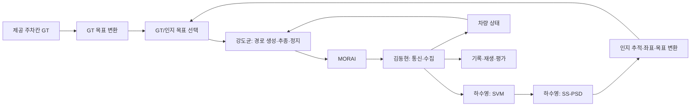

# 역할 분담과 주차 시스템 개발 순서

> **문서 역할:** 가이드 — 2026-11-10 사용자 확정 역할과 통합·일정 제안
> **담당:** 안승현·장원태 총괄/지원, 강도균·김동현·하수영 구현 — 5명 주업무 확정
> **최종 수정:** 2026-11-10

확정한 인지 기준선은 **SS-PSD**다. 최종 목표는 직접 구성한 센서로 주차칸을 인지하고 그 결과로 전방주차하는 것이다. GT 주차는 제어 개발과 비교 실험에 사용한다. 공개 가중치 적용에 이어 **직접 수집·라벨링한 MORAI 데이터로 추가 학습**하는 기존 목표도 유지한다.

이 문서는 과거의 DMPR-PS 우선 선정, 강도균의 센서/슬롯 기하 전담, 김동현의 수집 착수 유보, GT 폴리곤 자동 학습 라벨 계획을 대체한다. 상세 센서·모델 근거는 [SS-PSD 센서·BEV 설계](ss-psd-sensor-bev-baseline.md), 전체 연구 비교는 [5주 계획](parking-five-week-plan.md)을 따른다. 아래 신규 토픽과 노드는 구현 제안이며 이미 실행된 기능이 아니다.

## 1. 역할 검토

**현재 분담은 GT 제어·통신/수집·인지를 병렬로 개발하기에 적합하다.** 안승현은 센서셋을 확정해 11/10 공유할 예정이며, 안승현·장원태는 MORAI를 처음 사용하는 세 개발자의 총괄·질의응답을 맡는다. 장원태는 발표자료 제작·발표도 담당한다. 두 사람에게 별도 통합·평가·학습 모듈 구현 시간을 배정하지 않는다.

| 구분 | 담당 | 주업무 | 첫 인계 산출물 |
|---|---|---|---|
| **확정** | **강도균** | 제공 GT를 이용한 주차 경로 생성·추종·종단 정지 | 같은 목표 pose를 입력받는 계획/제어 모듈, GT 실행 로그 |
| **확정** | **김동현** | ROS bridge 연결·데이터 수집 코드 | 센서/상태/명령 채널 확인, 재생 가능한 bag와 수집 manifest |
| **확정** | **하수영** | SVM 구현·SS-PSD 사전학습 가중치 적용 | 오버레이 없는 BEV, 입구 접점·방향·신뢰도와 원본 시각 |
| **확정** | **안승현** | 센서셋 확정·공유, 전체 관리·MORAI 총괄·질의응답 | 센서 설정과 적용 방법, 공통 기준·막힌 문제의 판단 |
| **확정** | **장원태** | 발표자료 제작·발표, 안승현과 공동 관리·질의응답 | 개발자가 제공한 실행 증거·결과를 반영한 발표자료 |

앞서 제안했던 별도 지원 A/B 역할은 이 확정 분담으로 대체한다. 아래 통합·평가 세부 분담은 세 개발자의 모듈 경계 안에서 수행하기 위한 제안이며, 아직 구현되었다는 뜻은 아니다.

- 강도균은 경로·추종·정지와 목표 입력 어댑터를 담당한다. 하수영이 출력한 차량 기준 입구·방향을 지도 좌표의 목표로 바꾸는 최소 기능을 제어 입력 쪽에 두는 안을 제안한다. 기준점·원점 해석은 안승현에게 확인한다.
- 김동현은 통신·수집·재생과 원본 시각/차량 상태 기록을 담당한다. 인지 정확도 평가나 학습 로직까지 추가로 맡기지 않는다.
- 하수영은 확정 센서셋을 받아 SVM·SS-PSD와 픽셀→차량 좌표 출력을 담당한다. 공개 가중치 확인 후 소규모 추가 학습으로 진행하고, 라벨 규칙·검출 결과를 기록한다.
- 평가는 별도 대형 패키지보다 각 모듈의 CSV·검출 그림·주차 로그로 시작한다. 강도균은 종단 오차·실패, 하수영은 검출 오차, 김동현은 재생 가능한 입력을 제공하고 장원태가 발표자료로 정리한다.
- 라벨링은 하수영이 규칙과 예제를 정한 뒤 세 개발자의 남은 시간 안에서 분담하는 안을 제안한다. 안승현·장원태의 대량 라벨링·학습 실행을 전제로 하지 않는다. 10~20장 파일럿에서 실제 작업시간을 재고 수집량을 정한다.

## 2. 모듈 경계: 제어기가 목표 출처에 의존하지 않게 한다

초기에는 GT 목표로 계획/제어를 개발한다. 인지가 준비되면 **동일한 목표 인터페이스의 공급원만 교체**한다. 계획/제어 코드 내부에서 슬롯 ID에 따라 GT 좌표를 직접 조회하거나 인지 실패 시 GT 목표를 자동 대입하지 않는다.

GT 목표 어댑터와 인지 목표 어댑터는 출처를 구분해 실행하고, 최종 선택된 목표만 제어기에 전달한다. 검출된 여러 슬롯에서 목표를 지정하는 초기 MVP는 영상에서의 수동 선택/지역 후보 선택으로 단순화할 수 있다. 선택한 목표의 좌표는 영상 인지 결과를 사용하며 GT 좌표로 보정하지 않는다.

### 지금 합의할 인터페이스 초안

새 토픽명은 팀 계약에 반영하기 전의 제안이다. 경로만 있다고 이미 노드가 구현됐다는 뜻은 아니다.

| 데이터 | 표현·좌표계 | 책임 경계 |
|---|---|---|
| 원본 카메라·차량 상태 | 실제 촬영 시각, 카메라 frame, 센서 설정 버전. 기존 `/vehicle/odom`·`/vehicle/state` 활용 | 김동현 → 하수영/강도균/통합 |
| `/parking/bev/image` (제안) | `sensor_msgs/Image`, 512×512 BGR8, 10×10m. 원본 시각·유효 관측 mask·픽셀↔미터 변환 기록 | 하수영 → SS-PSD/수집 |
| 슬롯 관측 (메시지 미확정) | 입구 2점(m), 슬롯 안쪽 방향(rad), confidence, `base_link`, **획득 시각**, 유효성 | 하수영 → 강도균의 목표 입력 어댑터 (제안) |
| `/parking/goal_gt`, `/parking/goal_perception` (제안) | `geometry_msgs/PoseStamped`, `map`, **주차 완료 시 차량 base_link의 목표 pose** | 각 어댑터 → 입력 선택기 |
| `/parking/goal` (제안) | 위 두 입력 중 명시적으로 선택한 목표. 출처·선택/갱신 상태는 별도 기록 | 선택기 → 강도균 |
| `/parking/path` (제안) | 전진 MVP는 `nav_msgs/Path`, `map`; 속도 목표·정지 상태는 제어 모듈에 별도 명시 | 강도균 → 추종/평가/RViz |
| `/ctrl_cmd`, 기어 요청 | 실제 `morai_msgs/CtrlCmd`·기존 `/vip3_gear/set_gear` 사용 | 강도균 → 통신/MORAI |

`PoseStamped`에는 confidence·valid 필드가 없고 `Path`에는 속도·전후진 정보가 없다. 해당 정보가 필요하면 별도 상태/관측 메시지로 정하며 표준 메시지에 없는 필드를 있다고 가정하지 않는다. 후진 확장 때는 경로 구간별 기어와 정지 전환 계약을 추가한다.

### 목표 pose에서 특히 맞춰야 할 것

1. **칸 중심과 차량 기준점은 다르다.** 차체 중심을 칸 중심에 놓으려면 base_link가 뒷바퀴축인지 확인하고 그 offset을 목표에 반영한다. 차량 중심을 목표로 정했다면 제어기까지 같은 기준을 유지한다.
2. **입구와 방향을 정한다.** GT 직사각형의 장축만으로 전방주차 방향의 180° 모호성이 해결되지 않는다. 002 또는 008에서 실제 통로 쪽 입구와 차량의 최종 전방 방향을 확인한다.
3. **GT map과 차량 pose 원점을 대조한다.** GT 폴리곤·차량 footprint·출발 pose가 RViz에서 실제 장면과 일치하는지 먼저 확인한다.
4. 인지 결과는 획득 시각의 `base_link` 좌표에서 같은 시각의 pose/TF로 `map`에 옮긴다. 현재 시각의 pose와 과거 영상 점을 섞지 않는다.
5. SS-PSD의 출력은 입구·방향이며 독립적으로 측정한 네 코너나 점유 상태가 아니다. 깊이 prior·관측값을 구분하고 대상별 GT 깊이로 인지 목표를 완성하지 않는다.
6. 목표를 매 프레임 즉시 갈아 끼우지 않는다. 짧은 시퀀스에서 검출 안정성을 확인해 선택·추적하고, 유효성을 잃거나 재계획이 필요하면 상태기계에서 정지/재획득을 처리한다.

단위는 내부 위치 m·각도 rad로 고정한다. 실제 저장소 `CtrlCmd.front_steer`는 rad, `CtrlCmd.velocity`는 km/h이며 차량 상태 속도는 m/s다. 변환은 MORAI 출력 어댑터 한 곳에서 한다.

김동현의 진단용 명령 송신과 강도균의 제어기를 동시에 켜지 않는다. 자율 실행 중 `/ctrl_cmd` 송신자는 하나, 기어 서비스 소유자도 기존 노드 하나로 둔다. bridge 담당은 전달을 확인하고 제어 담당이 언제 어떤 명령을 낼지 결정한다.

## 3. 각자의 첫 3시간 작업에서 남길 것

| 담당 | 우선 작업 | 완료 증거 |
|---|---|---|
| 강도균 | 002/008 중 하나의 입구·목표·시작 pose 확인. GT 목표와 차량 제약을 읽는 코드부터 작성. 통신 전에는 오프라인 경로를 표시 | GT 칸·차량 footprint·목표·경로 그림과 실행 명령. 이어서 검증한 경로의 저속 추종 |
| 김동현 | 기존 rosbridge 기동·메시지/토픽 확인. 원본 카메라와 차량 상태를 짧게 기록하고 replay | 짧은 bag, 토픽/시각/실제 수신율 요약, 다른 PC에서도 재생하는 명령 |
| 하수영 | 공개 샘플 1장으로 SS-PSD 가중치 로드·추론부터 확인. SVM 입출력 규격 고정 | checkpoint 출처·hash, 검출 그림, BGR/512 입력 확인. 다음으로 확정 센서의 정차 영상으로 BEV |
| 안승현 | 센서셋 확정·공유, 초보 팀원의 MORAI 실행 안내와 공통 기준 확인 | 아래 센서 인계 자료, 최초 실행 방법과 질의응답 기록 |
| 장원태 | 발표자료 뼈대 준비, 안승현과 공통 질문 정리·개발자 진행 확인 | 실제 완료/미완료를 구분한 발표 초안, 개발자별 필요한 그림·로그 목록 |

### 오늘 올릴 센서셋의 인계 항목

안승현의 업로드는 예정 상태다. 실제 파일을 받아 확인하기 전에는 기존 임시 설정을 최종본이라고 표기하지 않는다. 전달 묶음은 다음을 권한다.

- MORAI에서 export한 센서 JSON, 차량 모델, 센서 버전과 적용 방법.
- 카메라별 위치·회전과 그 기준점/축/단위, 렌즈 모델·해상도·FOV·주기. SVM에 필요한 내부 파라미터·왜곡 계수는 실제 제공 여부와 확보 방법을 함께 기록.
- 센서별 ROS 토픽·메시지 타입·frame 이름, 네트워크 설정. 김동현이 실제 수신을 확인하고 하수영이 투영에 사용한다.
- 같은 정차 자세의 카메라별 원본 영상. 차체 옆 가까운 선과 카메라 경계의 겹침을 하수영과 확인한 뒤 대량 수집을 시작한다.

카메라 대수는 오늘 확정할 설정을 따르며 4대로 제한하지 않는다. 하수영은 센서 업로드 전에도 공개 샘플 추론을, 김동현은 bridge·차량 상태 연결을, 강도균은 GT 목표 개발을 진행할 수 있다.

환경 설치나 가중치 다운로드가 막히면 그 사실과 재현 명령을 기록한다. 실제 성공하지 않은 단계를 완료로 보고하지 않는다. 하수영은 김동현의 전체 수집 완료를 기다리지 않고 공개 샘플로 시작하고, 강도균은 인지 완료를 기다리지 않고 GT로 시작한다.

첫 공통 산출물은 **동일한 차량·칸·시작 자세의 짧은 재생 세션 1개**다. 이 세션으로 SVM·모델·좌표 변환을 반복 검증하면 매번 MORAI 연결부터 다시 할 필요가 줄어든다.

## 4. 앞으로의 개발 순서

### 1단계: 연결·공개 모델·GT 목표를 각각 확인

- 김동현: 센서와 상태의 입력, 명령과 기어의 응답을 실제로 확인한다.
- 강도균: GT 목표 위치·방향·차량 footprint를 확인하고 경로를 표시한다.
- 하수영: 공개 가중치 결과를 확보하고 정차 상태 SVM의 투영을 확인한다.
- 공동: map/base_link, m/rad, 시간 기준과 입력 규격을 확정한다.

### 2단계: GT 전방주차와 인지 오프라인 결과를 병렬 완성

강도균은 먼저 검증한 고정 경로를 추종해 제어·감속·정지를 분리 점검한 뒤, 다른 시작 pose에서도 GT 목표까지 차량 제약을 만족하는 경로를 생성하도록 확장한다. 빈 공간의 한 칸·한 방향에서 시작하며, 처음부터 후진/평행/혼잡 장애물 탐색을 모두 요구하지 않는다. 단순 보간 경로가 조향 한계를 만족한다고 가정하지 않는다.

하수영은 확정 센서의 저장 영상→SVM→SS-PSD로 입구·방향을 출력한다. 센서가 선을 못 보는 문제, 투영이 틀린 문제, 모델이 놓치는 문제를 구분한다. 김동현은 센서·캘리브레이션·BEV 버전을 묶어 수집하고 프레임 간 시각 차이와 누락을 기록한다.

센서·BEV를 고정한 뒤 10~20장 주석으로 loader/시각화 왕복을 검증하고 파일럿 데이터 수집·직접 라벨링을 진행한다. 임시 셋으로 대량 라벨링한 후 센서 배치를 다시 바꾸는 일을 피한다.

### 3단계: 인지 목표로 실제 차량을 연결하고 추가 학습

GT 목표 공급원을 인지 목표 공급원으로 바꾸고 동일 계획·제어를 사용한다. 한 칸에서 처음 센서 기반 주차가 되는지를 먼저 확인한다. 유실·잘못된 pairing·좌표 오류·추종 오류를 로그로 구분한다.

동시에 공개 SS-PSD와 MORAI 데이터로 지도 방식의 추가 학습을 수행한 모델을 비교한다. 학습 데이터 양은 주석 작업시간으로 조정한다. 반지도 전체 학습은 자원이 확인된 뒤 확장하지만 직접 수집·라벨링·추가 학습 목표 자체를 생략하지 않는다. 시험 run을 unlabeled 학습 풀에도 넣지 않는다.

### 4단계: 반복 평가와 기능 동결

- 개발: 002·008. 별도 확인: 009. 어려운 조건: 012·039.
- 동일 시작 자세에서 **GT 목표 vs 인지 목표**, 동일 시험 영상에서 **공개 가중치 vs 추가 학습**을 비교한다.
- 기록: 검출/미검출, 입구 위치·방향 오차, 목표 흔들림, 지연, 최종 차량 footprint·자세, 소요시간, 충돌·개입·실패 원인.
- 이미 잘 되는 전방주차를 반복 재현한 뒤 후방주차를 검토한다. 평행주차·새 모델 추가는 필수 결과가 확보된 경우의 확장이다.

## 5. 남은 기간과 주당 3시간 운영

현재 날짜는 **2026-11-10**이다. [저장소에 기록된 수업 공지](course.md)에는 **11/17 중간발표, 12/06 기능 동결, 12/15 최종발표**가 적혀 있다. 이는 9월 23일 공지를 기록한 문서이므로 이후 변경된 공지가 있다면 그 일정이 우선한다.

이 기록이 유효하다면 개발 기간은 약 4주다. 전체 팀 공수는 **5명×3시간×4주=60인시**지만, 구현을 맡은 세 사람의 가용 시간은 **3명×3시간×4주=36인시**다. 여기에 통합·질의응답·기록·라벨링도 포함되므로 순수 코딩 시간은 더 적다. 안승현·장원태의 24인시는 센서 확정·총괄·초보 지원·발표에 사용하며 별도 구현 여유로 계산하지 않는다. 5주 전체 기준도 총 75인시 중 개발자 가용 시간은 45인시다. 아래 날짜는 목표 제안이며 성공 보장이나 완료 사실이 아니다.

| 기간 | 목표 | 확보할 결과 |
|---|---|---|
| 11/10~11/16 | 통신·GT 경로·공개 가중치·센서 시험 | 각 모듈 실행 증거와 공통 replay 세션. 11/17에는 실제 완료 범위를 발표 |
| 11/17~11/22 | GT 전방주차, SVM/인지 오프라인, 파일럿 주석 | GT 시연, BEV 검출 결과, 학습 데이터/로더 검증 |
| 11/23~11/29 | 인지 목표 통합, MORAI 추가 학습 | 한 칸의 센서 기반 전방주차와 공개/추가 학습 비교 |
| 11/30~12/06 | 반복 평가·오류 수정·기능 동결 | GT/인지 비교표, 재현 가능한 실행 묶음 |
| 12/07~12/15 | 발표·영상·보고서·재현 | 최종 자료와 실행 절차. 신규 대형 기능 추가 없음 |

세 개발자의 주 3시간은 예를 들어 **모듈 작업 2시간 30분 + 공동 통합/질의응답 20분 + 기록 10분**으로 나눈다. 안승현·장원태는 같은 주당 시간 안에서 총괄·답변·발표를 진행한다. 매주 필요한 질문을 모아 재현 명령·오류 로그·화면과 함께 전달하고, 공통 답변을 기록해 같은 설치 문제를 반복 해결하는 시간을 줄인다.

이 예산에서는 **한 칸 전방주차, 최소 목표 변환, 소규모 직접 라벨링·추가 학습, GT/인지 및 공개/추가 학습 비교**에 집중한다. 별도 통합 플랫폼·자동 평가 대시보드·반지도 전체 학습·후방/평행주차를 필수 일정에 넣지 않는다. 센서 기반 주차와 추가 학습이라는 목표를 바꾸지 않되, 작업량이 넘치면 상태를 알리고 표본 수·확장 범위를 조정한다.

매주 인계는 코드만 보내지 않고 **커밋·실행 명령·입력 파일/run ID·결과 1개·남은 문제**를 함께 남긴다. 모든 모듈 완성 후 통합하는 대신 첫 주부터 예제 목표·짧은 bag로 연결한다.

## 6. 경로와 변경 관리

경로 오너십은 [architecture.md](architecture.md) §5를 따른다. 5명의 주업무는 사용자 결정이며 세부 통합 경계는 위 제안에 따른다. 센서셋 확정·배포는 안승현이 담당하고, 하수영은 투영/파라미터를, 김동현은 토픽/수신을 확인해 설정·TF·토픽을 한 변경 묶음으로 관리한다. 새 센서셋은 임시 v1/v2를 유지할 의무가 없다.

현재 문서 검토는 역할·계획·기존 소스의 정적 확인이다. 실제 ROS 연동·모델 추론·GT 주차·학습 성공을 새로 검증한 것은 아니다.
