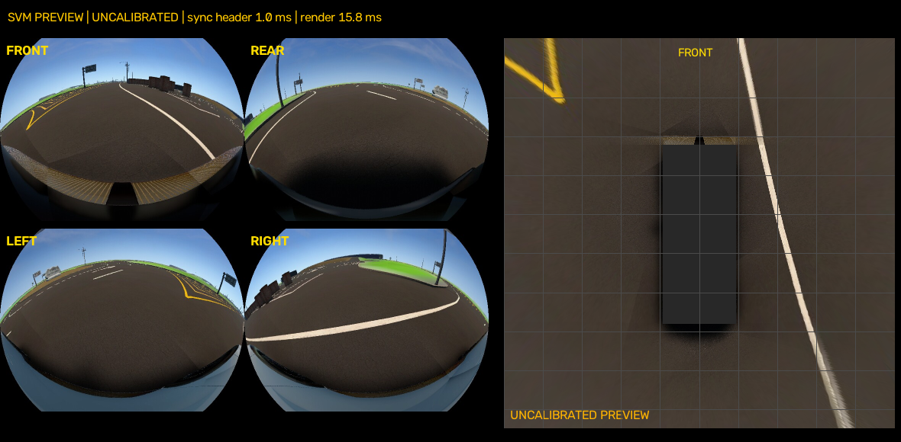
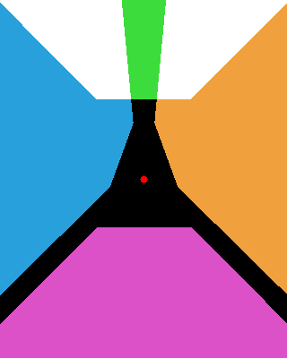
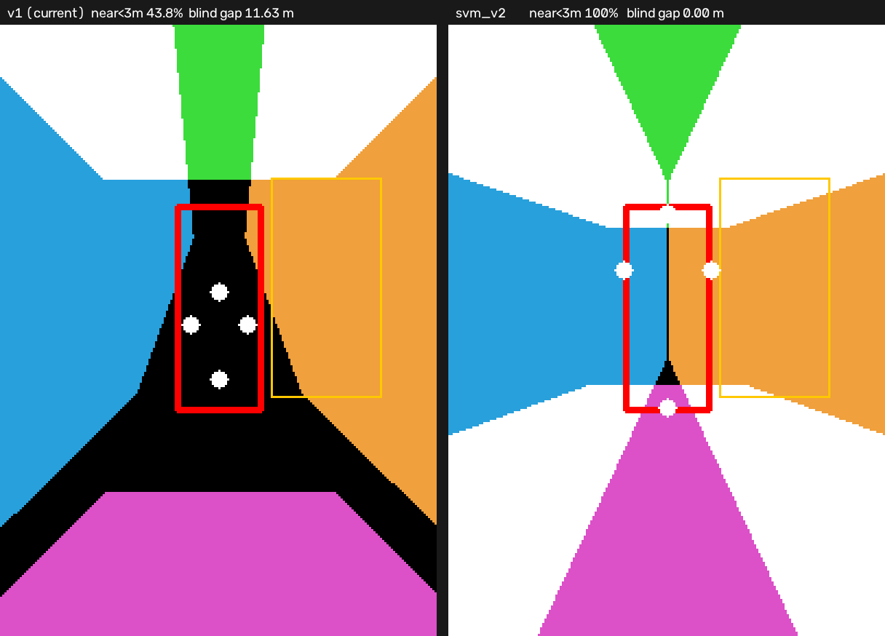

# 센서셋 — 261110 어안 구성과 과거 검토 기록

> **문서 역할:** 현재 센서 설정·연동 절차와 과거 설계 기록
> **담당:** 안승현 (센서셋 확정·공유) · 하수영 (SVM 연동) · 김동현 (통신·수집 연동)
> **기계 정본:** `config/VIP3_sensor_set_261110_ros.json`, `config/VIP3_network_261110.json`, `config/vip3_topics.yaml`
> **최종 수정:** 2026-11-10

**SS-PSD 채택 이후 설계 기준:** [SS-PSD 센서·BEV 기준](ss-psd-sensor-bev-baseline.md). AVM-SLAM의 4카메라 합성 구조와 SS-PSD의 10×10m·512×512 입력을 적용할 계획이다. 해당 문서의 수치도 실측 전 후보이며 아래 v1/v2 기록을 새 센서셋의 정답으로 사용하지 않는다.

## 현재 적용: 2026-11-10 export

사용자가 제공한 `261110_VIP3_Sensor_26.R1.H3.json` 및 `261110_VIP3_Network_26.R1.H3.json`을 검토했다. 원본은 `../data/`에 보존하고 저장소에는 방향별 ROS 토픽으로 정리한 센서셋과 네트워크 원본의 LF 줄바꿈 사본을 둔다. 네트워크 JSON 값은 바꾸지 않았다. **아래 §1 이후의 v1/v2 구성은 과거 기록이며 현재 적용값이 아니다.**

| ID / 방향 | 위치 x,y,z (m) | roll,pitch,yaw (°) | ROS frame |
|---|---|---|---|
| 1 전방 | 3.80, 0, 0.40 | 0, 35, 0 | cam_front |
| 2 후방 | −0.80, 0, 0.30 | 0, 35, 180 | cam_rear |
| 3 좌측 | 2.10, 1.05, 0.70 | 0, 45, 90 | cam_left |
| 4 우측 | 2.10, −1.05, 0.70 | 0, 45, 270 | cam_right |

공통: FishEyeCamera(`modelType=2`), RGB, 640×480, Horizontal FOV 179°, 10 Hz, JPEG 품질 90, ROS(`commType=3`). LiDAR/GPS/IMU는 이번 export에 없다. `reserved_sensors`는 구형 코드의 토픽 이름만 보존하며 현재 필수 수신 항목이 아니다.

- 원본 카메라 4대의 Topic이 모두 `/image_jpeg/compressed`였다. 수정본은 `/cam_{front,rear,left,right}/image_jpeg/compressed`, frame은 위 표와 같다. 위치·회전·렌즈·해상도·주기는 변경하지 않았다. `/compressed` 포함 여부는 실제 export 형식을 따르며 수신 토픽으로 다시 확인한다.
- 새 네트워크에는 `/ctrl_cmd`가 있다. 외부 `PUBSUB_TYPE=771`, `Division_TYPE=3`이며 실제 ROS 설정은 `config` 대신 `EgoCtrlConfig`에 있다. `_PUBSUB_TYPE=0`만 보고 누락으로 판정하면 안 된다. 명령 송신·차량 이동 검증은 센서 미리보기와 별도다.
- 원본 마지막 `PUBSUB_TYPE=4865`, `netType=8` 항목도 보존했다. ROS가 아닌 채널의 기본 `rosConfig` 문자열을 활성 토픽으로 읽지 않는다.
- 센서 원본 SHA-256: `cbc7a6d642cbd12ff146a47cfa31215b166831a02cae5ba8279cdbe356ea337b`.

### 실행

기본 포트는 9090이다. 이 PC에서는 Windows의 TCP 예약 범위 9011–9110에 포함되어 Docker publish가 실패했다. rosbridge의 WebSocket Host 포트 검사 때문에 안팎 포트를 동일하게 맞춘다. 예약 범위를 변경하지 않고 호스트 19090 → 컨테이너 19090을 사용한다. 다른 PC는 먼저 `netsh interface ipv4 show excludedportrange protocol=tcp`로 확인한다.

```bash
# 호스트: 필요할 때만 대체 포트를 지정한다.
MORAI_BRIDGE_PORT=19090 ./scripts/docker_ros_up.sh up
python3 tools/export_local_morai_presets.py --port 19090 --output-dir ../data/local_morai
# 출력된 두 JSON을 MORAI에서 Import하고 Connect / Play.
# 포트 변경은 컨테이너 내부 ROS_MASTER_URI를 바꾸는 작업이 아니다.
```

```bash
# 컨테이너
./scripts/build_ws.sh
./scripts/rosbridge.sh
# 별도 터미널
source devel/setup.bash
python3 scripts/verify_morai_topics.py --profile runtime --duration 15 \
  --json-out /data/sensor_checks/261110_live/topics.json
roslaunch drivable_bev fisheye_svm.launch save_dir:=/data/sensor_checks/261110_live
# 별도 터미널: raw 패널에는 네 원본 영상과 SVM이 함께 표시된다.
rqt_image_view /perception/svm/panel
```

`save_dir`는 첫 유효한 4뷰 묶음의 원본 PNG, `svm_panel.png`, `svm_preview.png`, `valid_mask.png`, 설정과 타임스탬프를 저장한다. 다시 캡처하려면 새 디렉터리로 노드를 재시작한다. 미수신·지연 0.5초 초과·뷰간 시간 차이 60ms 초과에서는 합성을 보류하고 패널에 대기 상태를 표시한다. 헤더 시간이 0이면 도착 시각 기반임을 명시한다. 토픽 목록에 이름이 있다는 것만으로 수신 성공으로 판단하지 않는다.

### 미리보기와 캘리브레이션의 구분

새 `fisheye_svm.launch`는 기존 핀홀 `rgb_bev.launch`와 별도다. [OpenCV fisheye 모델](https://docs.opencv.org/4.x/db/d58/group__calib3d__fisheye.html)의 광선 투영과 `cv2.remap`을 사용한다. 초기값 `f=640/radians(179)`, `D=0`은 **MORAI 렌즈를 측정한 결과가 아닌 등거리 모델 가정**이다. JSON의 `focalLengthpixel=320`이나 `lensDistortion=[0,0,0]`을 이 모델의 교정값으로 해석하지 않는다.

노면 z=−0.35m, pitch 부호, 차체 마스크도 검증 대상이다. 합성 범위 10×10m, 출력 512×512, 중심 x=1.525m는 SS-PSD 입력을 위한 초기 설계다. 미리보기에는 `UNCALIBRATED PREVIEW`가 들어가며 학습·평가·제어 입력으로 연결하지 않았다. 실제 주차선 직선성, 이음부 오차, 차체 가림과 차 옆 유효 영역을 확인한 뒤 K/D·외부 파라미터·노면을 보정하고 깨끗한 모델 입력을 별도로 만든다. 현재 유효 마스크는 가정한 기하의 결과이며 실제 가시성 보증이 아니다.

검증: `check_sensor_preset.py`(JSON·토픽 계약·SVM 위치 일치), `check_topic_contract.py`, `check_node_imports.py`, `check_launch_params.py`, fisheye 단위 테스트. ROS 전체 빌드에서 발견한 `vip3_hd_map`의 package/setup 버전 불일치는 0.2.0으로 통일했다. 실기 결과는 [수신 보고서](analysis/sensor-check-261110.json)에 기록했다.

### 실기 결과 (2026-11-10)

Windows → rosbridge WebSocket handshake와 MORAI 접속 확인 후 15초 측정했다. 카메라 4대는 9.987–10.004Hz, `/Ego_topic`은 44.802Hz(설정 50Hz)였고 수신 검사 및 26.R1 메시지 스키마 게이트를 통과했다. `/ctrl_cmd`에는 MORAI의 구독자가 연결되어 있으며 차량 명령을 보내는 시험은 하지 않았다.

SVM 미리보기 출력은 약 5Hz다. 첫 저장 묶음의 헤더 시각 차이는 1.0ms, 합성·패널 처리 시간은 15.8ms였다. 이 한 묶음의 수치는 전체 실행의 지연 분포가 아니다. rqt 창에 `/perception/svm/panel`을 연결했고 원본 4장과 합성 결과를 저장·검토했다. 도로선은 보이지만 차체/범퍼가 합성에 남고 이음부에 왜곡이 있으므로 **주차칸 정확도나 360° 무사각 검증 완료를 뜻하지 않는다.** 주차선이 있는 위치에서 대응점과 렌즈·노면을 보정하는 것이 다음 단계다.



검증에는 이미 설치된 ROS Noetic 런타임 이미지에서 VIP3 전체 catkin workspace를 빌드해 사용했다. 저장소 전용 Docker 이미지를 새로 빌드한 결과로 보고하지 않는다. OpenCV 5.0.0에서 fisheye 테스트 7개, 수집 bag 프로파일 테스트 10개와 정적 검사 4개를 통과했다.

## 1. 과거 상태 기록

**11/10 역할 확정:** 안승현이 오늘 센서셋을 확정해 공유할 예정이다. 새 파일을 받아 실제 적용하기 전까지 아래 임시 JSON을 최종 설정으로 취급하지 않는다. 인계 항목과 연동 담당은 [roadmap.md](roadmap.md) §3을 따른다.

**11/10 실기 확인 갱신:** 사용자가 FishEyeCamera의 Horizontal FOV 상한 179°와 네 카메라의 어안 출력 화면을 확인했다. 현재 시험은 [4어안 설정안](morai-fisheye-sensor-trial.md)을 따른다. 아래 과거 핀홀 계산·대역폭 추정은 현재 어안 영상의 검증 결과가 아니다.

**v1은 다른 프로젝트에서 가져온 임시 센서셋이며 이번 주차 프로젝트의 배치 기준이 아니다.** 차량 바로 옆 주차선을 관측하는 SVM이 되도록 위치·자세·렌즈를 다시 정한다. v2/v3도 과거 계산 후보이며 실측으로 확정된 권장값이 아니다. 최신 근거와 절차는 [DMPR-PS·SS-PSD 및 SVM 재설계 검토](parking-perception-svm-review.md)를 따른다.

아래 기하 수치의 100%·사각 0m는 가정한 지면·차체 영역·투영 모델에서의 계산이다. 차체의 광선 가림, 실제 렌즈, 해당 차량 치수를 검증하지 않았으므로 실제 커버리지·검출 성능으로 해석하지 않는다. 설정 파일은 이 문서 수정으로 변경되지 않았다.

원본은 로컬 루트 `../data/VIP3_sensor_set_v1.json`(UDP 설정)이고, 저장소의
`config/VIP3_sensor_set_v1_ros.json`은 이를 **ROS 전송으로 바꾸고 토픽·frame_id를 팀 규약으로
채운 것**이다. 변환은 재현 가능하다:

```bash
python3 tools/make_ros_sensor_set.py \
  --input  "../data/VIP3_sensor_set_v1.json" \
  --output "config/VIP3_sensor_set_v1_ros.json"
```

MORAI Sensor 설정에서 이 파일을 Import 한다.

> `commType: 3` 이 ROS 를 뜻한다고 보고 변환했다. 근거는 `VIP3_network_v1.json`의 ROS 항목이
> 전부 `netType=3, commType=3`이고, MORAI gRPC proto 의 `NetworkCommType` 이
> `UNSPECIFIED=0, UDP=1, TCP=2, ROS=3, ...` 이기 때문이다. **센서 열거가 같은지는 시뮬레이터에서
> 한 번만 확인하면 된다** — UI 에서 카메라 하나를 손으로 ROS 로 바꿔 Export 한 뒤
> `cameraList[0].cc.commType` 값을 보면 끝난다. 다르면 `--comm-type <값>` 으로 다시 돌린다.

## 2. 구성

base_link = **뒷바퀴축 중심**, x 전방 · y 좌 · z 상 (REP-103).

| ID | 센서 | 위치 (x,y,z) m | 회전 (roll,pitch,yaw) deg | 해상도 / FOV | 토픽 | frame | 주기 |
|---:|---|---|---|---|---|---|---:|
| 1 | front camera | 1.900, 0.000, 1.200 | 0, 2, 0 | 1280×720 / 90° | `/cam_front/image_jpeg/compressed` | `cam_front` | 20 Hz |
| 2 | left camera | 1.150, 0.650, 1.200 | 0, 10, 70 | 640×480 / 130° | `/cam_left/image_jpeg/compressed` | `cam_left` | 20 Hz |
| 3 | right camera | 1.150, −0.650, 1.200 | 0, 10, 290 | 640×480 / 130° | `/cam_right/image_jpeg/compressed` | `cam_right` | 20 Hz |
| 4 | **rear camera** | −0.100, 0.000, 1.200 | 0, 2, 180 | 1280×720 / 90° | `/cam_rear/image_jpeg/compressed` | `cam_rear` | 20 Hz |
| 5 | Lidar3D | 0.800, 0.000, 1.450 | 0, 0, 0 | — | `/velodyne_points` | `velodyne` | 10 Hz |
| 6 | GPS | 0.350, 0.000, 1.250 | 0, 0, 0 | — | `/gps` | `gps` | 5 Hz |
| 7 | IMU | 0.000, 0.000, 0.000 | 0, 0, 0 | — | `/imu` | `imu` | 50 Hz |

카메라 1~3은 ASMC `ASMC_sensor_set_v2` 와 **완전히 같다.** 4번만 다르다 — ASMC 는
(0, 0, 1.400) pitch 328° 의 하향 카메라였고, VIP3 는 후방 카메라다.

## 3. 내부 파라미터 — JSON 값을 믿지 말 것

센서셋 JSON 의 `focalLengthpixel: 320.0` 은 **네 카메라 모두 틀렸다.** 해상도와 FOV 로 다시
계산한다:

```
fx = fy = (width / 2) / tan(horizontal_fov / 2)
cx, cy = width / 2, height / 2        # JSON principalPoint 와 우연히 같다
```

| 카메라 | fx (px) | JSON 값 | 배율 오차 |
|---|---:|---:|---:|
| front / rear | **640.000** | 320.0 | 2.00× |
| left / right | **149.219** | 320.0 | 0.47× |

`lensDistortion`은 네 대 모두 `[0,0,0]`이며 기존 BEV 호모그래피는 무왜곡 핀홀·수평 FOV 가정으로 계산한다. 이것만으로 실제 MORAI 모델과 정확히 일치한다고 확정할 수 없다. 재설계 시 렌즈 모델과 내부 파라미터의 의미를 출력 영상으로 검증한다.

## 4. 이 센서셋의 한계 — 숫자로

`tools/analyze_sensor_set_coverage.py` 로 계산한다 (시뮬레이터 불필요):

```bash
python3 tools/analyze_sensor_set_coverage.py \
  --sensor-set "../data/VIP3_sensor_set_v1.json" \
  --image /tmp/coverage.png
```

주차 격자 x[−10,10] y[−8,8], 지면 z = −0.35 m 기준:

| 반경 | 어느 카메라든 보이는 비율 | front | left | right | rear |
|---|---:|---:|---:|---:|---:|
| 0–2 m | **9.1 %** | 0 % | 4.6 % | 4.5 % | **0 %** |
| 2–4 m | 69.7 % | 0 % | 27.7 % | 27.7 % | 14.3 % |
| 4–6 m | 91.9 % | 11.9 % | 31.7 % | 31.7 % | 24.8 % |
| 6–8 m | 94.9 % | 19.0 % | 32.9 % | 32.9 % | 24.8 % |

방위별 최근접 가시 지면 거리:

| 방향 | 최근접 | 보는 카메라 |
|---|---:|---|
| 정면 (0°) | 4.50 m | front |
| 좌측 (90°) | 1.75 m | left |
| **후좌 대각 (130°)** | **12.65 m** | ← **사각** |
| 정후방 (180°) | 2.70 m | rear |
| **후우 대각 (230°)** | **12.85 m** | ← **사각** |
| 우측 (270°) | 1.75 m | right |

**결론 세 가지.**

1. **차 반경 1.65 m 안쪽 지면은 어느 카메라에도 안 잡힌다.** 주차칸에 들어가는 마지막 구간이 전부
   여기다.
2. **전방 카메라는 4.5 m 앞부터 본다.** pitch 2° 에 높이 1.2 m 라 그 이상 가까운 노면이 화각 밖이다.
3. **후좌·후우 대각 130°/230° 에 사각 쐐기가 있다.** 좌/우 카메라(화각 130°)와 후방
   카메라(화각 90°) 사이가 벌어져서 생긴다. 후진 주차에서 차가 실제로 향하는 방향이다.

이 결론은 MORAI 의 pitch 부호 규약과 무관하다 — 부호를 반대로 두면 0–2 m 가시율이 9.1 % 에서
**0 %** 로 더 나빠질 뿐이다 (`--pitch-sign -1` 로 확인 가능).



위 그림은 x[−10,10] y[−8,8] 격자다. 위가 전방. 초록 = front, 주황 = left, 파랑 = right,
자홍 = rear, 흰색 = 2대 이상 중복, **검정 = 어느 카메라도 못 보는 곳**, 가운데 빨간 점 =
base_link. 좌우 아래로 뻗은 검은 쐐기 두 개가 후좌·후우 대각 사각이고, 가운데 검은 덩어리가
근접 사각이다.

## 5. SVM(어라운드뷰) 과거 v2 배치 후보 — 실측 미검증

주차 슬롯 검출 논문 대부분이 **AVM/SVM 합성 영상**을 입력으로 가정한다. 지금 센서셋은 그
반대 극단이라 카메라 4대를 **위치·자세·화각 전부** 바꿔야 한다. 각도만 틀어서는 안 된다.

`tools/design_svm_sensor_set.py` 가 `drivable_bev` 런타임과 **같은 캘리브레이션 코드**로
후보를 평가한다. 아래 숫자는 전부 그 출력이다.

```bash
python3 tools/design_svm_sensor_set.py --preset svm_v2 \
    --compare config/VIP3_sensor_set_v1_ros.json --image /tmp/svm.png
python3 tools/design_svm_sensor_set.py --sweep          # FOV x pitch 탐색
```

### 당시 계산에 사용한 후보값

| view | 위치 (x,y,z) m | 회전 (r,p,y) deg | 해상도 | FOV | 어디에 다는 건가 |
|---|---|---|---|---:|---|
| front | **3.700, 0.000, 0.650** | 0, **38**, 0 | 1280×960 | **150** | 앞범퍼 그릴 |
| left | **2.400, 1.000, 1.000** | 0, **55**, 90 | 1280×960 | **150** | 좌측 사이드미러 아래 |
| right | **2.400, −1.000, 1.000** | 0, **55**, −90 | 1280×960 | **150** | 우측 사이드미러 아래 |
| rear | **−0.750, 0.000, 0.950** | 0, **42**, 180 | 1280×960 | **150** | 뒷범퍼/테일게이트 |

내보낸 센서셋: `config/VIP3_sensor_set_v2_svm.json` (sha256 `0c9cd7e6…`)
경량판: `config/VIP3_sensor_set_v2_svm_light.json` (640×480, sha256 `0a936208…`)

### 무엇이 달라지나

| 지표 | v1 (현재) | svm_v2 |
|---|---:|---:|
| 근거리(r<3 m) 가시율 | 43.8 % | **100 %** |
| r<1 m 가시율 | **0 %** | **100 %** |
| 범퍼 밖 사각 폭 (최악) | **11.63 m** | **0.00 m** |
| 격자 전체 (차체 제외) | 83.7 % | **100 %** |
| 2대 이상 중복 (스티칭 여유) | 18.0 % | **52.6 %** |
| 15 cm 주차선 @ 좌 1 m | 23.2 px | 13.7 px |
| 15 cm 주차선 @ 후 1 m | **안 보임** | 13.8 px |
| 15 cm 주차선 @ 후좌 대각 | **안 보임** | 13.7 px |



왼쪽이 현재, 오른쪽이 svm_v2. 격자는 x[−6,8] y[−5,5]. 빨간 사각 = 차체,
노란 사각 = 주차면 한 칸(2.5×5.0 m), **검정 = 사각**, 흰색 = 2대 이상 중복.
왼쪽의 검은 영역이 오른쪽에서 전부 사라지고 차체 둘레가 흰색(중복)으로 바뀐다.

### 왜 이 값인가 — 설계 논리 네 줄

1. **아래는 당시 탐색 격자와 핀홀 모델에 한정한 결과다.** 카메라의 수직 하방 지면을 포함하려면
   `pitch + 수직반각 ≥ 90°` 여야 한다. 수직반각은 수평 FOV 와 종횡비로 정해진다.
   `--sweep` 결과: FOV 150~160 은 pitch 40~70 전 구간에서 성립, FOV 140 은 pitch 45+,
   FOV 130/pitch 65 등의 조합을 후보로 얻었다. 특정 탐색 범위에서 통과하지 않았다는 결과는 그 FOV로 SVM 자체가 불가능하다는 뜻이 아니다.
2. **종횡비를 16:9 → 4:3 으로.** 같은 수평 FOV 에서 수직 화각이 6~8° 더 나온다.
   SVM 은 "지면을 얼마나 아래까지 보는가"가 전부라 종횡비가 FOV 만큼 중요하다.
   (FOV 150 기준 수직반각: 16:9 → 64.5°, 4:3 → 70.3°)
3. **카메라를 낮추고 바깥으로 뺀다.** 현재는 4대 전부 z=1.2 m 에 차 안쪽(x 1.15~1.9)이라
   자기 차체가 시야를 가린다. 실제 AVM 은 그릴(0.65 m) · 미러 아래(1.0 m) ·
   테일게이트(0.95 m)에 단다.
4. **측면 yaw 를 70° → 90° 로.** 정확히 옆을 보게 해야 전/후 카메라와 대각에서 겹친다.
   현재 70°/290° 배치가 후좌 130° · 후우 230° 쐐기를 만든 직접 원인이다.

### ⚠ 먼저 확인할 것 — MORAI 가 FOV 150 을 허용하는가

이 과거 설계의 계산은 **초광각 핀홀 화각**에 달려 있다. 여기서 사용한 카메라 모델은 핀홀
(`f = w / (2·tan(fov/2))`) 가정이라 FOV를 올릴수록 fx가 작아지고 180°에 접근하면 0에 접근한다. 이 극한을 실제 180° 어안 투영과 동일하게 취급할 수 없다.
UI 가 어디서 막는지는 **시뮬레이터에서 1분이면 확인된다** — 카메라 하나의 FOV 를
150 으로 올려 저장해 보면 된다.

| UI 최대 FOV | 할 것 |
|---|---|
| ≥ 150 | 넓은 FOV 후보를 실제 차량의 가림·선 픽셀 폭과 함께 검증 |
| 140 | pitch·높이·위치 조합을 다시 평가. 다른 배치와 동등하다고 단정하지 않음 |
| 130 | 과거 프리셋은 탐색 후보일 뿐, 실제 근접 관측과 겹침 확인 필요 |
| < 130 | 필요한 지면 영역·배치·하향각·가림을 다시 계산하고 실제 영상 확인. 필요하면 카메라 추가 검토 |

[MORAI 공식 문서](https://help-morai-sim-en.scrollhelp.site/morai-sim-standard-en/sensors)는 `Fish Eye Camera`를 명시하며 사용자가 현재 출력도 확인했다. **어안은 FOV≥180°로 정의되지 않는다.** 현재 179°도 핀홀 전용 `drivable_bev`에 그대로 넣을 수 없다. 범위 검사를 통과해도 렌즈 투영식은 별도로 맞춰야 한다. 실제 투영식과 JSON `modelType` 번호는 export·기술 자료로 확인한다. 왜곡 계수를 임의로 0으로 두어 기존 핀홀 코드에 맞추지 않는다.

### 대역폭 — 여기서 결정이 갈린다

rosbridge 는 이미 최대 미지수다 ([simulator.md](simulator.md) §5). JPEG q90 기준 개략 추정:

| 구성 | @20 Hz | @10 Hz |
|---|---:|---:|
| v1 (현재) | 6.5 MB/s | 3.3 MB/s |
| **svm_v2** (1280×960 ×4) | **13.1 MB/s** | 6.5 MB/s |
| **svm_v2_light** (640×480 ×4) | **3.3 MB/s** | 1.6 MB/s |

**`svm_v2_light` 로 시작할 것을 권한다.** 기하가 완전히 같아서 가시율·사각은 `svm_v2` 와
동일(100 % / 0.00 m)하고, 대역폭은 **현재보다도 절반**이다. 당시 계산의 픽셀 폭만으로 검출에 충분하다고 보장할 수 없다. 실제 선의 두께·거리·기울기·주변부 해상도와 검출 실패를 보고 해상도를 정한다.

### 바꾸면 같이 고칠 것

센서셋을 바꾸면 네 곳이 같이 바뀐다. 하나라도 빠지면 BEV 가 조용히 틀린다
([architecture.md](architecture.md) §5):

1. `config/VIP3_sensor_set_v2_svm*.json` — MORAI 에서 Import
2. `config/vip3_topics.yaml` — 위치·회전·해상도·FOV
3. `src/perception/drivable_bev/config/cameras_vip3_v1.yaml` — **`source_sha256` 포함**
4. `src/vip3_bringup/launch/static_tf.launch` — `python3 tools/dump_static_tf.py` 출력으로 교체

그리고 **BEV 격자를 다시 볼 것.** 지금은 `x[−10,10] y[−8,8]` 인데 SVM 은 근거리가
촘촘해지는 대신 원거리 해상도가 떨어지므로 `x[−6,8] y[−5,5] res 0.03` 쪽이 맞을 수 있다.
`--image` 출력으로 주차면 한 칸이 어떻게 들어오는지 보고 정한다.

> **TwinLiteNet+ 가중치는 이 배치에서 성능이 떨어진다.** 학습 데이터가 K-City 주행 영상
> (전방 90° / 측면 130°, 거의 수평)이라 150° 를 55° 숙인 영상은 분포 밖이다. SVM 으로
> 가는 순간 **재학습 또는 모델 교체가 전제**가 된다 — 하수영의 기반 논문 선정과 묶어서
> 결정할 것.

### 후방을 코너 2대 + 번호판 fisheye 로 나누면? — 검증 결과

제안받은 구성을 같은 도구로 평가했다 (`--preset svm_v3_rear6` / `svm_v3_rear5`).

| 구성 | 근거리 가시 | 2대 이상 중복 | 후진 목표칸 cm/px | @20Hz | 예상 추론 Hz |
|---|---:|---:|---:|---:|---:|
| svm_v2 (4대) | 100 % | 52.6 % | 2.33 | 13.1 MB/s | 12.5 |
| **svm_v3_rear5** (5대, 코너 2) | 100 % | **81.6 %** | **0.94** | 16.3 MB/s | 10.4 |
| svm_v3_rear6 (6대, +번호판) | 100 % | 81.9 % | 0.94 | 19.6 MB/s | 9.0 |

"후진 목표칸" = 뒷범퍼 뒤 0~5 m, |y| < 1.5 m. 후진 주차에서 실제로 봐야 하는 구간이다.

**① 코너 2대는 값어치가 있다. 단 이유가 처음 생각한 것과 다르다.**

커버리지는 이미 4대로 100 % 라 더 얻을 게 없다. 실제 이득은 두 가지다.

- **중복률 52.6 % → 81.6 %.** 스티칭 이음매가 줄고, 무엇보다 **목표 주차칸을 서로 다른
  두 방향에서 본다.** 지면 평면 가정 BEV 는 주차된 옆 차를 시선 방향으로 길게 번지게
  하는데, 시선이 두 개면 그 번짐을 구분할 수 있다. 이게 가장 실질적인 이득이다.
- 후진 목표칸 중복률이 12.2 % → 97.4 % 로 올라간다.

**② 해상도 2.5배 향상은 상당 부분 MORAI 핀홀 모델의 착시다. 설계 근거로 쓰지 말 것.**

변인을 하나씩 바꿔 원인을 분리했다 (정후방 3.5 m 지점 cm/px):

| 바꾼 것 | cm/px |
|---|---:|
| 기준 (x −0.75, z 0.95, yaw 180) | 2.54 |
| **높이만** z 1.45 로 | 2.61 ← **이득 없음** |
| 코너 위치로 옮기고 yaw 180 유지 | 2.61 ← **이득 없음** |
| 기준 위치에서 **yaw 만** 135° | 1.80 |
| 코너 위치 + yaw 135° | **1.40** |

즉 이득의 대부분이 **광축에서 벗어난 각도**에서 온다. 핀홀(rectilinear) 투영은 광축에서
멀수록 입체각당 픽셀이 촘촘해진다 (45° 에서 ×2.83). **실제 어안 렌즈는 정반대로 가장자리를
압축한다.** 이 수치는 해당 핀홀 계산의 결과이며 현재 FishEyeCamera 출력에 적용할 수 없다. 어안은 실제 투영식과 원본의 선 해상도로 별도 평가한다.

**③ 번호판 fisheye 는 이 모델에서 거의 기여가 없다 — 단 모델의 한계 때문일 수 있다.**

rear5 와 rear6 이 사실상 같다 (0.94 vs 0.94 cm/px, 중복 81.6 vs 81.9 %). 그런데 이 분석은
**지면 평면만 보고 차체 자가 가림을 모델링하지 못한다.** 실제로는 루프라인(z 1.45)에 단
코너 카메라는 화면 아래쪽에 테일게이트·범퍼가 들어온다. 번호판 높이(z 0.55)에 단 카메라는
그 가림 없이 범퍼 바로 뒤를 본다 — **이게 실제 AVM 이 번호판에 카메라를 다는 이유고, 내가
숫자로 확인해 줄 수 없는 부분이다.**

→ 코너 2대를 먼저 달고 **실제 영상에서 테일게이트가 얼마나 가리는지 본 뒤** 번호판 카메라를
추가할지 정한다.

**④ 2026-10-27 정정 — DMPR-PS·SS-PSD는 합성된 SVM 한 장을 입력받는다.**

카메라 5~6대로 합성했다는 이유만으로 신경망 입력 차원이나 기존 가중치 호환성이 깨지지는 않는다. 차량 위치·방향, 지면 스케일, 차체 마스크, 이음매 등 합성 영상의 분포를 맞춰야 한다. 원본 다중 카메라 입력을 받는 다른 네트워크와 구분한다.

4대는 공수와 일반적인 SVM 구성을 고려한 시작안이다. 실제 사각이 해결되지 않으면 보조 카메라를 검토할 수 있다. 위 표의 카메라 수에 따른 예상 추론 Hz는 **SVM 한 장을 한 번 추론하는 DMPR-PS·SS-PSD에 적용하지 않는다.** 전송·합성 비용과 검출기 비용을 분리해 측정한다.

### 외부 검증 — 논문 두 편의 실제 구성과 대조

저장소 밖에 clone 한 논문 코드에서 실제 카메라 설정을 확인했다
(저장소 목록: [related-work.md](related-work.md) §1).

**① 다른 차량의 장착 위치는 참고 사례다.** ParkingE2E(IROS 2024, 실차)의 설정이
front (3.67, 0.04, 0.71) / left (2.09, 0.98, 1.02) yaw 89.91 / rear (−0.90, −0.05, 0.65) 로
과거 계산 후보와 유사하다. 그러나 차량 모델·기준점·차체 가림을 검증하지 않았으므로 우리 차량의 정답 좌표로 확정하지 않는다.

**② pitch 는 렌즈·설치 높이·차체 형상과 함께 결정한다.** 비교 사례의 front pitch 4.16°만으로 현재 어안의 pitch를 정하지 않는다. 과거 38~55° 값 역시 계산 후보이며, 현재 FishEyeCamera에서는 근접 선·겹침·가림을 보며 조정한다.

**③ "사각 0"이 필요조건은 아니다.** e2e-parking-carla(IV 2024)는 CARLA 에서 **핀홀 FOV 100,
400×300, 측면 pitch 40, z 1.5** 로 돌았다. vhalf(100°, 4:3) = 41.8° 라 pitch 40 을 더해도
81.8° < 90°, 즉 **차체 바로 옆은 안 보이는 구성인데도 IV 2024 에 실렸다.** 우리 `svm_v2` 는
그보다 공격적인 목표이고, 여유가 없으면 그쪽 수준으로 타협해도 된다.

**④ 다른 과제의 해상도를 충분성 근거로 쓰지 않는다.** E2E 경로 예측과 근접 표식의 정밀 좌표 검출은 요구가 다르다. 640×480도 초기 후보이며 1280×960 등과 실제 오차·지연을 비교한다.

**⑤ BEV 격자도 같다.** ParkingE2E 가 `bev_x/y_bound [-10, 10, 0.1]`. 우리는
`x[-10,10] y[-8,8] res 0.05` — Y 범위가 다르고 격자 간격은 절반이다. DMPR-PS·SS-PSD 입력은 별도 모델별 crop·물리 스케일 정합이 필요하다.

### 아직 남는 한계

- **차체 자가 가림을 모델링하지 못했다.** 이 분석은 지면 평면만 본다. 실제로는 범퍼·미러가
  화면 하단을 가린다. 시뮬레이터에서 실제 영상을 봐야 확정된다.
- **스티칭은 별도 작업이다.** 4장을 한 장으로 합치려면 `drivable_bev` 의 융합 결과
  (`/perception/bev/camera/*`)를 쓰거나, RGB 서라운드(`rgb_bev_node.py`)를 쓴다.
  후자가 이미 돌아가므로 SVM 영상이 필요하면 그쪽을 먼저 본다.
- 지면 평면 가정 때문에 **주차된 옆 차는 시선 방향으로 길게 번진다.** SVM 이어도 같다.
  LiDAR 점유로 보정하는 것이 정석이다.

## 6. Semantic 카메라 (기존 검토 기록)

MORAI Capture Mode 를 쓰면 **장착된 RGB 카메라마다** Intensity / Semantic / Instance / Depth PNG
가 한 번에 나온다. 즉 **학습 GT 만 필요하면 Semantic 카메라를 따로 달 필요가 없다.**

실시간 ROS Semantic 스트림이 필요할 때만 추가한다. 그때 지킬 것:

- `m_SensorUniqueID` 는 8, 9, 10, 11 (기존 1~7 과 충돌 금지)
- **`cc.cameraType: 1`** 이 Semantic (RGB 는 0)
- `pos` / `rot` / 해상도 / FOV 를 짝이 되는 RGB 카메라와 **완전히 동일하게** 복사
- 토픽은 `/sem_front/...`, `/sem_left/...`, `/sem_right/...`, `/sem_rear/...`
- **무손실이어야 한다.** 마스크 생성기가 클래스 색을 정확히 일치 비교하므로 JPEG 압축이 한 번이라도
  끼면 전부 깨진다. 안티에일리어싱도 꺼야 한다.
- MORAI 팔레트에 **주차칸 선 전용 클래스가 없다.** 주차 슬롯 라인은 `white_lane (255,255,255)`
  또는 `yellow_lane (255,255,0)` 로 칠해질 가능성이 높다. **이게 실제로 무슨 색인지 확인하는 것이
  팀 전체의 가장 싼 결정적 실험이다** — KATRI 주차장에서 캡처 한 장이면 된다.

## 7. 확인해야 할 것 (첫 연동 때)

- [ ] 센서 `commType` ROS 열거값이 3 인가
- [ ] 카메라 토픽에 `/compressed` 가 자동으로 붙는가, 아니면 전체 문자열을 써야 하는가
- [ ] `rostopic hz` 로 카메라 4대 실제 수신율. rosbridge 는 base64 JSON 이라 20 Hz × 4대가
      안 나올 가능성이 높다 → [simulator.md](simulator.md) §5 의 완화 순서
- [ ] `header.stamp` 가 0 이 아닌가, sim time 인가 wall time 인가
- [ ] MORAI pitch 양수가 렌즈 아래인가 위인가 (지면 격자 오버레이로 확정)
- [ ] base_link 원점이 정말 뒷바퀴축 중심인가 (`/Service_MoraiMapSpec` 또는 LiDAR 지면 비교)
- [ ] 지면 z 가 −0.35 m 가 맞는가 (KATRI 평지에서 LiDAR 평면 피팅)
