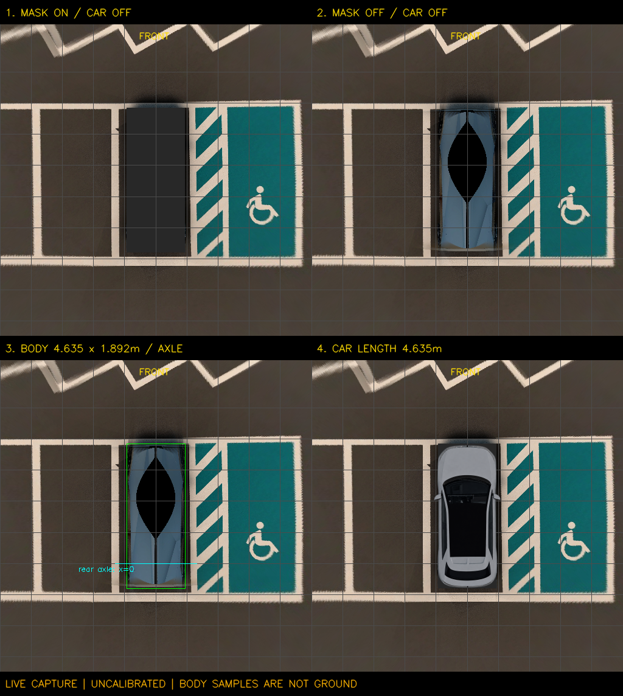
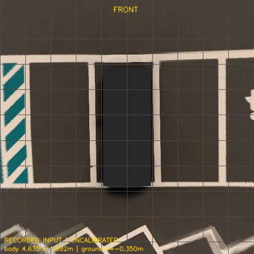
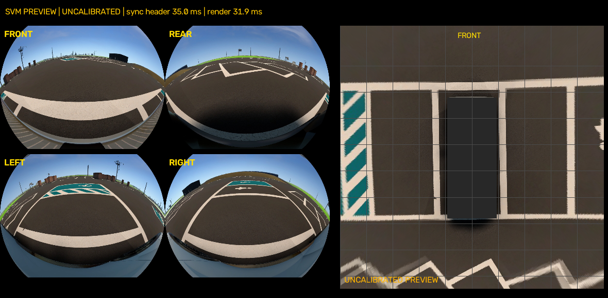

# 현재 4어안 센서셋과 SVM

> **문서 역할:** 현재 센서 설정·연동 절차·검증 근거
> **담당:** 안승현 (센서셋 확정·공유) · 하수영 (SVM 연동) · 김동현 (통신·수집 연동)
> **기계 정본:** `config/morai/sensors.json`, `config/morai/network.json`, `config/ros/topics.yaml`
> **최종 수정:** 2026-11-11

**SS-PSD 채택 이후 설계 기준:** [SS-PSD 센서·BEV 기준](ss-psd-sensor-bev-baseline.md). AVM-SLAM의 4카메라 합성 구조와 SS-PSD의 10×10m·512×512 입력을 적용할 계획이다. 초기 후보 수치는 연구 기록이며 현재 적용값은 아래 정본을 따른다.

## 현재 적용: 2026-11-10 export

사용자가 제공한 `261110_VIP3_Sensor_26.R1.H3.json` 및 `261110_VIP3_Network_26.R1.H3.json`을 검토했다. 원본은 `../data/reference/morai_exports/261110/`에 보존하고 저장소에는 방향별 ROS 토픽으로 정리한 센서셋과 네트워크 원본의 LF 줄바꿈 사본을 둔다. 네트워크 JSON 값은 바꾸지 않았다. 구형 v1/v2 프리셋은 Git 이력에만 남겼다. [파일 위치·공유 기준](../config/README.md).

| ID / 방향 | 위치 x,y,z (m) | roll,pitch,yaw (°) | ROS frame |
|---|---|---|---|
| 1 전방 | 3.85, 0, 0.30 | 0, 35, 0 | cam_front |
| 2 후방 | −0.80, 0, 0.30 | 0, 35, 180 | cam_rear |
| 3 좌측 | 2.10, 1.05, 0.70 | 0, 45, 90 | cam_left |
| 4 우측 | 2.10, −1.05, 0.70 | 0, 45, 270 | cam_right |

공통: FishEyeCamera(`modelType=2`), RGB, 1280×960, Horizontal FOV 179°, 10 Hz, JPEG 품질 90, ROS(`commType=3`). LiDAR/GPS/IMU는 이번 export에 없다. `reserved_sensors`는 구형 코드의 토픽 이름만 보존하며 현재 필수 수신 항목이 아니다.

- 최초 export의 중복 토픽을 방향별로 분리했고, 재수정 export에도 `/cam_{front,rear,left,right}/image_jpeg/compressed`와 위 frame이 유지되어 있다. 새 전방 위치와 네 카메라 해상도를 그대로 반영했다. 최신 원본의 19090 접속값은 팀 공유본에서 **9090**으로 정규화하고 원본 파일은 보존했다.
- 새 네트워크에는 `/ctrl_cmd`가 있다. 외부 `PUBSUB_TYPE=771`, `Division_TYPE=3`이며 실제 ROS 설정은 `config` 대신 `EgoCtrlConfig`에 있다. `_PUBSUB_TYPE=0`만 보고 누락으로 판정하면 안 된다. 명령 송신·차량 이동 검증은 센서 미리보기와 별도다.
- 원본 마지막 `PUBSUB_TYPE=4865`, `netType=8` 항목도 보존했다. ROS가 아닌 채널의 기본 `rosConfig` 문자열을 활성 토픽으로 읽지 않는다.
- 센서 원본 SHA-256: `559e5952d0fdf05b1b15653eeca2e112a8a5942354cb4ba6ea0d60ed95293859`.

### 실행

**팀 기본값은 9090이다.** 공유 센서/네트워크 JSON, Docker compose, bridge 스크립트, 프리셋 출력 도구가 모두 9090을 기본으로 사용한다. 팀원은 별도 포트 인자를 지정할 필요가 없다.

```bash
# 호스트: 팀 기본 실행 (9090)
./scripts/docker_ros_up.sh up
# MORAI Import:
#   config/morai/sensors.json
#   config/morai/network.json
# ROS Connect / Play
```

현재 검증 PC만 Windows 예약 포트(9011–9110) 문제로 **19090을 로컬 예외**로 사용한다. 팀 공유 기본값을 바꾸는 설정은 아니다. 동일한 문제가 있는 PC에서만 아래 명령으로 로컬 사본을 만든다. WebSocket Host 검증 때문에 외부·내부 포트를 동일하게 사용한다.

```bash
MORAI_BRIDGE_PORT=19090 ./scripts/docker_ros_up.sh up
python3 tools/export_local_morai_presets.py --port 19090 --output-dir ../data/local_morai
# 이 경우에만 출력된 로컬 사본 두 개를 MORAI에 Import한다.
```

```bash
# 컨테이너
./scripts/build_ws.sh
./scripts/rosbridge.sh
# 별도 터미널
source devel/setup.bash
python3 scripts/verify_morai_topics.py --profile runtime --duration 15 \
  --json-out /data/sensor_checks/261110_1280x960/topics.json
roslaunch drivable_bev fisheye_svm.launch save_dir:=/data/sensor_checks/261110_1280x960
# 별도 터미널: raw 패널에는 네 원본 영상과 SVM이 함께 표시된다.
rqt_image_view /perception/svm/panel
```

`save_dir`는 첫 유효한 4뷰 묶음의 원본 PNG, `svm_panel.png`, `svm_preview.png`, `valid_mask.png`, 설정과 타임스탬프를 저장한다. 다시 캡처하려면 새 디렉터리로 노드를 재시작한다. 미수신·지연 0.5초 초과·뷰간 시간 차이 60ms 초과에서는 합성을 보류하고 패널에 대기 상태를 표시한다. 헤더 시간이 0이면 도착 시각 기반임을 명시한다. 토픽 목록에 이름이 있다는 것만으로 수신 성공으로 판단하지 않는다.

### 미리보기와 캘리브레이션의 구분

새 `fisheye_svm.launch`는 기존 핀홀 `rgb_bev.launch`와 별도다. [OpenCV fisheye 모델](https://docs.opencv.org/4.x/db/d58/group__calib3d__fisheye.html)의 광선 투영과 `cv2.remap`을 사용한다. 초기값 `f=1280/radians(179)`, `D=0`은 **MORAI 렌즈를 측정한 결과가 아닌 등거리 모델 가정**이다. JSON의 `focalLengthpixel=320`이나 `lensDistortion=[0,0,0]`을 이 모델의 교정값으로 해석하지 않는다.

차량 제원과 노면 기준은 아래 11월 11일 검증 결과를 적용한다. 합성 범위 10×10m, 출력 512×512를 유지하고 중심은 차체 제원에서 계산한 x=1.5275m다. 미리보기에는 `UNCALIBRATED PREVIEW`가 들어가며 학습·평가·제어 입력으로 연결하지 않았다. 실제 주차선 직선성, 이음부 오차, 차체 가림과 차 옆 유효 영역을 확인한 뒤 K/D·외부 파라미터·노면을 보정하고 깨끗한 모델 입력을 별도로 만든다. 차량 높이를 확인한 것이 렌즈 캘리브레이션 완료를 뜻하지 않는다.

### Ioniq5 제원·지면 기준 확인 (2026-11-11)

공통 설정은 [2023_hyundai_ioniq5.yaml](../src/perception/drivable_bev/config/vehicles/2023_hyundai_ioniq5.yaml)이다. SVM은 이 파일에서 차체 마스크·영상 중심·지면 평면을 계산한다. 제원 계산은 캘리브레이션의 `GroundPlane` 클래스를 사용하며, 기존 핀홀 후보 분석 도구도 이 제원·지면 기준을 읽는다. 실제 시뮬레이터 창에서 `2023_Hyundai_Ioniq5`, `26.R1.H3`, `R_KR_PR_K-city_2025`를 확인했다.

| 항목 | 기록값 | 근거 |
|---|---:|---|
| 전장 / 차체 폭 | 4.635 / 1.892 m | 사용자 제공값과 MORAI 문서 |
| 축거 | 3.000 m | 문서 및 설치 차량 자산의 바퀴 축 위치 |
| 전방 / 후방 오버행 | 0.845 / 0.790 m | 문서, 자산의 차체 전후 경계와 일치 |
| 최대 바퀴 조향각 | 40° | 문서 및 설치 차량 controller |
| 최소 회전반경 | 5.87 m | 문서; 반경을 재는 기준점은 미명시 |
| 문서상 전고 | 2.434 m | 문서 원문값 보존, 아래 자산과 불일치 |
| 자산 전체 bounding box 폭 / 높이 | 약 2.161 / 1.644 m | 설치된 모델의 돌출부 포함 외곽 상자 |
| 바퀴 반지름 | 0.360 m | 네 바퀴 physics component |
| 현 정차 위치의 지면–base_link | 약 0.3513 m | 실시간 TF와 해당 도로 충돌 메시 대조 |
| SVM 공통 높이 기준 | 0.350 m | 정차 측정값을 반올림; 지면 z=−0.350 m |

문서 출처: [MORAI 26.R1 Vehicle Specification](https://help-morai-sim.scrollhelp.site/ko/morai-sim-drive/26.R1/vehicle-specification). 문서상 전고와 설치 자산의 bounding box 높이가 달라 각각 출처를 남겼다. **전고 2.434m를 카메라 높이나 base_link 높이로 사용하지 않는다.** 폭 1.892m는 차체 마스크에 사용하며, 돌출부를 포함한 2.161m 상자와도 구분한다. 5.87m를 자전거 모델의 뒷바퀴 축 회전반경으로 바로 사용하지 않는다.

측정 근거는 [수치·파일 해시·좌표 기록](analysis/vehicle-geometry-261111.json)에 있다. 5초간 TF/Ego 각각 222개를 수신했고 최대 속도는 약 0.000051m/s였다. 평균 base_link 고도 28.500054m에서 도로 충돌 삼각형의 같은 위치 고도 28.148737m를 빼면 **0.351317m**다. 자세를 포함해 base_link z축으로 환산하면 0.351324m다. 설치된 차량의 반지름 0.36m와 실제 하중·서스펜션 상태의 차고를 혼동하지 않는다.

지면은 현재 위치 주변에서도 약간 기울어져 있다. 반경 5m의 도로 꼭짓점 15개를 base_link로 변환한 평면 피팅은 원점 높이 −0.35060m, 잔차 RMS 약 3.43mm였다. 해당 위치의 기울기 계수는 기록에 보존하고, 일반 실행 기준은 **z=−0.35m의 수평 평면**으로 둔다. 다른 위치·주행 상태까지 동일한 차고를 측정했다는 의미는 아니다. `ground_reference.dz_dx/dz_dy`를 교정하면 어안 투영에도 반영된다.

카메라 JSON의 z는 여전히 base_link 상대값이다. 전·후방 `z=0.30m`, 좌·우측 `z=0.70m`는 수평 지면 기준으로 대략 **0.65m / 1.05m 높이**다. JSON에 0.35m를 더해 센서를 이동시키지 않는다.

투영 원본의 중앙 차체 영역은 **고정된 진회색 사각 마스크**이며 실제 차체 segmentation이 아니다. 마스크 범위는 `x=[−0.790, 3.845]m`, `y=[−0.946, 0.946]m`이고, 그 영역의 유효 마스크는 0이다. 이전 전방 끝 3.800m를 3.845m로 바로잡고, 화면 중심도 1.525m에서 **1.5275m**로 제원에서 계산하도록 바꿨다. 전폭 2.161m의 거울 포함 상자를 통째로 가리지 않으므로 사이드미러·범퍼 잔상은 별도 가림 검증이 필요하다. 마스크 밖 검은 영역도 투영 범위 밖이거나 관측이 없는 픽셀일 수 있다.

**차량 탑뷰 표시 (2026-11-11):** 사용자가 제공한 원본은 로컬 `data/reference/vehicles/`에 보존하고, 패키지의 [ioniq5_top_view.png](../src/perception/drivable_bev/config/vehicles/ioniq5_top_view.png)를 팀 공유용 기본 표시 이미지로 사용한다. 알파값 4 이하의 거의 투명한 여백을 제외해 외곽을 구하고, 전장 4.635m에 맞춰 원본 가로세로 비율을 유지한다. 차량 앞은 화면 위쪽이며 중심은 base_link의 전방 1.5275m다. 거울 포함 표시 폭은 약 2.16m, 512×512 / 10×10m SVM에서는 약 110×237픽셀이다. 차체 폭 1.892m에 거울까지 압축하지 않는다.

차량 이미지는 `/perception/svm/preview/compressed`와 `/perception/svm/panel` 및 패널의 compressed 토픽에만 합성한다. 격자는 차량 이미지 아래에 그린다. `FisheyeSvm.render()`와 `/perception/svm/valid_mask`는 기존 기하 처리를 유지한다. 표시 이미지는 차체 segmentation이나 관측 데이터가 아니므로 인지 입력으로 사용하지 않는다. `save_dir` 지정 시 `svm_preview.png`에는 차량 표시가 들어가고, 새 `svm_projection.png`에는 차량 이미지·격자·문구를 합성하기 전의 미보정 투영을 저장한다. `capture.json`에 표시 이미지와 크기 정보를 기록한다.

`roslaunch drivable_bev fisheye_svm.launch vehicle_overlay:=false`로 차량 그림을 끌 수 있고, `vehicle_image:=/절대경로/차량.png`로 앞쪽이 위를 향한 투명 PNG를 지정할 수 있다. 이미지를 읽지 못하면 경고 후 사각 마스크로 표시한다. Docker 재빌드는 필요 없다.

### 마스크 제거 비교 (2026-11-11 실시간 수신)

사각형 색칠, 차체 내부 제외, 광선의 차체 가림 제외를 모두 끈 **진단용 투영**과 기본 표시를 비교했다. 차체 이미지는 지면으로 늘어나며 중앙에 미관측 검은 영역이 남는다. 이 영상은 실제 차체 탑뷰나 주행 가능 영역이 아니다.

차량 그림 중심은 x=1.5275m이고 외곽은 제원의 앞·뒤 위치와 맞는다. 10m/512픽셀에서 그림의 전장은 237픽셀=4.6289m, 거울 포함 폭은 110픽셀=2.1484m다. 목표 전장 4.635m와의 차이 약 6.1mm, 표시 폭 2.16m와의 차이 약 11.6mm는 한 픽셀(19.5mm) 이내의 반올림이다. 이는 표시 크기 검증이며 렌즈·주차선 스케일 보정 완료를 뜻하지 않는다.

```bash
# 마스크와 차량 그림을 모두 끄고 확인
roslaunch drivable_bev fisheye_svm.launch vehicle_mask:=false vehicle_overlay:=false
# 마스크 없이 그림만 비교하려면 vehicle_overlay:=true
# 기본 표시로 복귀: roslaunch drivable_bev fisheye_svm.launch
```

`vehicle_mask:=false`는 미리보기에만 적용한다. 유효 마스크와 `svm_projection.png`는 기존 차체 제외 처리를 유지한다. `save_dir` 지정 시 진단용 영상은 `svm_unmasked.png`에 따로 저장하고 `capture.json`에 표시 모드를 기록한다.

4뷰 헤더 차이 34.0ms의 실제 수신 묶음으로 확인했다. 설정 정리 후 SVM·BEV 80개, bag 10개, 진단 7개 테스트와 정적 검사 4개를 통과했으며 독립 ROS에서 마스크 해제 launch도 검증했다. 마지막 실시간 재검사 시점에는 사용자 ROS master가 종료돼 있었으며, 앞선 실시간 캡처와 구분한다. [수치 기록](analysis/svm-mask-inspection-261111.json), 원본 4뷰와 비교 출력은 로컬 `/data/sensor_checks/261111_mask_inspection/`에 있다.



기존에 실행 중인 SVM은 설정을 자동으로 다시 읽지 않는다. **SVM 터미널만** `Ctrl+C` 후 `source devel/setup.bash && roslaunch drivable_bev fisheye_svm.launch`로 다시 시작하면 적용된다. bridge나 MORAI 센서 프리셋을 바꿀 필요는 없다.

변경 후 fisheye 테스트 10개와 센서·토픽·import·launch 정적 검사를 통과했다. 최종 미리보기 시점에는 ROS master와 사용자 노드가 종료돼 새 프레임을 수신하지 못했다. 아래는 **11월 10일에 저장한 실제 1280×960 4뷰를 새 제원으로 재처리한 결과**이며, 새 실시간 수신 결과가 아니다. 제원 적용 후에도 렌즈·이음부는 미보정 상태다.



검증: `check_sensor_preset.py`(JSON·토픽 계약·SVM 위치 일치), `check_topic_contract.py`, `check_node_imports.py`, `check_launch_params.py`, fisheye 단위 테스트. ROS 전체 빌드에서 발견한 `vip3_hd_map`의 package/setup 버전 불일치는 0.2.0으로 통일했다. 최신 실기 결과는 [1280×960 수신 보고서](analysis/sensor-check-261110-1280x960.json)에 기록했다.

### 최신 실기 결과: 1280×960 (2026-11-10)

전방 위치 `(3.85, 0, 0.30)m`와 카메라 4대의 1280×960 입력을 반영한 후, 15초 카메라 수신 검사에서 **9.969–10.014Hz**를 확인했다. SVM 출력은 **약 5Hz**다. 첫 저장 묶음의 헤더 시각 차이는 35.0ms, 합성·패널 처리 시간은 31.9ms이며 전체 실행의 지연 분포를 뜻하지 않는다. 이전과 촬영 장소가 달라 해상도 개선 효과를 직접 비교한 실험으로 해석하지 않는다.

주차칸 위치에서 실제 4뷰와 합성 영상을 저장·검토했다. 새 입력은 1280×960이지만 SS-PSD 규격에 맞춘 SVM 출력은 512×512, 범위는 10×10m로 유지했다. 주차선은 보이지만 차체/범퍼 흔적과 이음부 오차가 남아 **주차칸 좌표 정확도·완전한 무사각 검증은 아직 아니다.** rqt의 `/perception/svm/panel`에서 현재 영상을 볼 수 있다.



이번 수신 검사는 카메라 4대만 대상으로 했다. 차량 상태·제어 채널을 재검증한 결과로 보고하지 않는다. 이전 640×480 검사에서 확인한 Ego 44.802Hz와 CtrlCmd 구독 연결 기록은 [이전 보고서](analysis/sensor-check-261110.json)에 보존했다.

OpenCV 5.0.0의 ROS Noetic 환경에서 fisheye 테스트 7개와 JSON·토픽·TF·기본 포트 검사를 통과했다. 렌즈 파라미터와 노면 높이의 초기 가정은 그대로이며, 실제 교정 완료로 표시하지 않는다.
