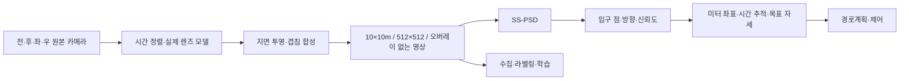

# SS-PSD 기준선과 MORAI 센서·SVM/BEV 설계

> **문서 역할:** 가이드 — 확정한 인지 기준선, 코드 조사, 센서·BEV 설계 후보와 검증 순서
> **담당:** 팀 공동 — 센서·인지·데이터·제어 담당
> **최종 수정:** 2026-11-10

사용자 결정: **SS-PSD 공개 가중치 → 직접 수집·라벨링한 MORAI 데이터로 학습 → 인지 기반 주차**를 주 경로로 삼는다. DMPR-PS는 비교·구현 참고용이다. 센서와 영상 합성은 **AVM-SLAM(IROS 2024)의 AVM 전처리 구조**, 검출기 입력은 **SS-PSD의 10×10m·512×512 규격**, 정합 확인은 **Click-Calib(2025)의 지면 대응점 평가 방식**을 참고한다.

**센서 설계 제약 갱신:** 사용자는 기존 임시 센서셋을 유지할 필요가 없다고 명시했다. v1/v2의 센서 종류·대수·장착 위치·각도·FOV를 유지 조건으로 삼지 않는다. 4카메라는 두 기준 논문의 시작 구성이며 우리 차량에서 충분하다고 검증된 결론이나 최대 대수가 아니다. 실제 근접 관측과 겹침이 부족하면 배치·렌즈를 바꾸거나 보조 카메라를 추가한다.

이 문서의 카메라 좌표·각도·처리율·합격 기준은 프로젝트 설계 후보다. MORAI 실행으로 검증한 최종 설정이 아니며 기존 센서 JSON·TF·런치에는 적용하지 않았다. 실제 대량 수집 전에 센서·투영·입력 규격을 확정한다.

**11/10 UI·출력 확인:** 사용자가 FishEyeCamera의 Horizontal FOV 상한 **179°**와 그 설정의 네 카메라 출력 화면을 확인했다. [4어안 설정 시험안](morai-fisheye-sensor-trial.md)을 179°로 수정했으며 종전 180~200° 입력 제안은 적용하지 않는다. 전체 가시성·캘리브레이션은 아직 미검증이며 과거 핀홀 계산을 어안 결과로 사용하지 않는다.

## 1. 클론과 확인 범위

워크스페이스 기준 경로이며 팀 저장소 밖에 둔다.

| 용도 | 로컬 경로 | 업스트림 | 확인 HEAD |
|---|---|---|---|
| 비교·참고 | `external/parking/DMPR-PS` | [Teoge/DMPR-PS](https://github.com/Teoge/DMPR-PS) | `72dc056abe0a953049cc62aca0cc6b85f12b03f0` |
| **주 기준선 SS-PSD** | `external/parking/CRPS-D` | [zzh362/CRPS-D](https://github.com/zzh362/CRPS-D) | `e516cc49a0bfaa198130b223a1978c42a2c0449d` |

DMPR-PS는 기존 정상 클론을 확인했고 CRPS-D는 이번에 새로 얕은 클론을 만들었다. 두 클론의 작업 트리는 깨끗하다. SS-PSD 공식 저장소의 이름은 CRPS-D이며 다른 비공식 `SS-PSD` 저장소를 받은 것이 아니다.

외부 클론은 참조 원본으로 유지하고, 필요한 런타임 어댑터·학습 변경은 팀 저장소에서 관리한다. 이번에는 가중치 다운로드·모델 실행·학습을 수행하지 않았다. [공식 SS-PSD 가중치 링크](https://drive.google.com/file/d/11gJcAly9MXBbe02PQ5g4Uuhi8AUnza1S/view?usp=drive_link), [공식 주석 도구 링크](https://drive.google.com/file/d/1muVTCgz8Tg6dSIZy7Ql4zcT7r8ZWsfxq)는 README에서 확인했다.

## 2. 어떤 논문을 어느 부분의 기준으로 삼는가

**T-ITS**는 **IEEE Transactions on Intelligent Transportation Systems**라는 지능형 교통 분야 학술지의 약칭이다. “T-ITS 2025”는 해당 학술지의 2025년 논문이라는 서지 표기다. SS-PSD는 알고리즘 이름이고 CRPS-D는 데이터셋·공식 저장소 이름이다. [IEEE 학술지 안내](https://ieee-itss.org/pub/t-its/), [SS-PSD 게재 DOI](https://doi.org/10.1109/TITS.2025.3612466)

| 역할 | 기준 논문 | 가져올 부분 | 이번 범위 |
|---|---|---|---|
| **인지·데이터 표현·입력 스케일** | [SS-PSD / Advancing Real-World Parking Slot Detection…](https://arxiv.org/html/2509.13133v1), T-ITS 2025 | 방향 표식 점과 기하 pairing, CRPS-D의 10×10m·512×512, 공개 가중치 | 공개 모델과 MORAI 추가 학습 비교. 반지도 재현 여부는 별도 구분 |
| **센서·SVM 생성 구조** | [AVM-SLAM](https://arxiv.org/html/2309.08180v2), IROS 2024, §IV-A | 4개 주변 어안 영상의 왜곡 처리 → IPM → 합성 BEV | AVM 전처리만 적용. SLAM·루프 폐쇄·반사 제거 신경망은 필수 아님 |
| **캘리브레이션 확인** | [Click-Calib](https://arxiv.org/html/2501.01557v3), 2025 preprint | 인접 카메라의 같은 지면 점을 이용해 정합 오차 확인 | MORAI 설정값으로 먼저 투영하고, 오차가 남으면 외부 파라미터 보정 검토 |

AVM-SLAM §V-A와 저자 데이터는 4개 어안 원본 **1280×960**, 합성 BEV **1354×1632·약 1.05cm/px**, 두 영상 시퀀스의 **저장률 10Hz**를 명시한다. 논문에서 실시간 BEV 합성은 30Hz로 구분한다. 이는 센서·합성의 참고 사례이며 이 BEV 크기를 SS-PSD에 그대로 넣지는 않는다. SS-PSD에 들어갈 영상은 SS-PSD 기준으로 다시 생성한다. [AVM-SLAM 저자 데이터 설명](https://yale-cv.github.io/avm-slam_dataset/)

**장착 부위 근거:** SS-PSD §III-A는 사이드미러 장착을 명시하지만 미러 아래쪽·정확한 높이/각도는 본문과 Fig. 3에서 확인되지 않는다. SS-PSD의 원본 카메라 해상도도 확인되지 않았으며 512×512는 합성 영상 규격이다. AVM-SLAM은 주변 4대라고 설명하고 미러 아래 장착은 명시하지 않는다. 아래의 미러 아래·외측 위치와 XYZ·pitch는 우리 차량용 제안이다.

“센서셋 기준 논문 한 편”을 고르면 AVM-SLAM이다. 다만 해당 논문이 우리 차량의 XYZ·pitch·최적 FOV를 정해 주는 것은 아니다. 카메라 배치 검증과 캘리브레이션 최적화도 서로 다른 작업이다. Click-Calib은 보이지 않는 지면을 보이게 만드는 알고리즘이 아니다.



SVM은 주변 카메라를 합성하는 시스템이고 BEV는 그 결과의 시점이다. 이 구성은 지면 기하로 합성하므로 BEV 생성 자체에 GPU 학습을 추가하지 않는다. 모델 앞에 TwinLite 등의 segmentation 출력을 넣는 구조도 아니다.

### 두 논문의 실제 카메라 수와 충분성

- **SS-PSD / CRPS-D:** §III-A와 Fig. 3에서 데이터 수집 장비에 **어안 카메라 4대**를 명시한다. 10×10m·512×512 합성 영상이 검출기 입력이다. 차량 전체 센서의 최적 설계나 특정 IONIQ 5의 캘리브레이션을 제공하는 논문은 아니다.
- **AVM-SLAM:** §IV-A에서 **주변 어안 카메라 4대**의 왜곡 처리·IPM·합성을 명시한다. 전체 시스템에는 IMU와 wheel encoder도 포함되지만 SVM 영상은 4카메라로 생성한다.
- **우리 적용:** 4대만으로 원하는 근접 지면이 실제 관측되고 표식 해상도와 이음매 품질이 확보되면 그 구성을 채택한다. 수평 360° 시야와 차체 바로 옆 지면 관측은 서로 다른 조건이다.

더 많은 카메라를 장착해도 SVM에는 일부만 사용할 수 있다. 반대로 6대 모두 SVM에 합성할 수도 있다. SS-PSD는 합성 영상 한 장을 처리하므로 4→6대가 검출기 입력 차원이나 프레임당 호출 횟수를 바꾸지는 않는다. 원본 취득·전송·동기화·합성 비용, 이음매와 영상 분포는 달라진다.

### Motional IONIQ 5에서 공개된 내용

2026-11-10에 공식 회사·제조사 자료를 확인했다. **장착 부위와 센서별 역할은 참고할 수 있다.** 이번에 확인한 자료에서는 그대로 MORAI에 가져올 전체 XYZ/RPY·카메라 K/D·센서 간 변환 파일을 찾지 못했다. 사진에서 좌표를 추정한 결과를 공식 캘리브레이션으로 취급하지 않는다.

| 공개 근거 | 확인한 내용 | 우리 설계에 반영할 점 |
|---|---|---|
| [Motional 엔지니어 Jeremy Myers의 공식 차량 설명](https://www.linkedin.com/posts/motional_come-take-a-tour-of-our-ioniq-5-robotaxi-activity-7491166713263280128-gAhF) | 전면 범퍼의 근거리 LiDAR 아래 **180° 광각 카메라**, 루프의 좁은·중간 화각 카메라와 LiDAR, 측면 센서, 후방 스포일러 내장 카메라 | 근거리와 원거리 센서를 서로 다른 위치·렌즈로 구성. 180°가 수평/수직 중 무엇인지와 정확한 투영식은 이 설명만으로 확정하지 않음 |
| [Motional 하드웨어 설계 설명, 2021](https://motional.com/news/how-motional-built-our-next-generation-robotaxi-less-year) | 카메라·레이더·LiDAR를 합쳐 **30개 이상**, 서로 다른 렌즈/FOV와 근거리·원거리 센서 조합 | 센서 총개수와 SVM용 카메라 수를 구분 |
| [Motional 2026 VSSA §3.4.2.1.1, 인쇄 p.15](https://motional.com/sites/default/files/inline-files/Motional_Voluntary_Safety_Self-Assessment_2026.pdf) | 차량 가까운 물체와 먼 교통상황을 함께 관측하고 센서 FOV를 겹치게 배치 | 주차 과제에서는 차체 주변 관측·이음매 겹침을 직접 검증 |
| [현대자동차그룹 공식 소개, 2021](https://www.hyundaimotorgroup.com/ko/story/CONT0000000000002058) | 루프, 전·후면 범퍼, 좌우 펜더에 분산 장착한 사진·설명 | 장착 가능한 부위와 차체 가림을 검토하는 참고 자료 |

우리 판단은 **근접 주차선용 낮은 외곽 카메라를 우선 배치**하는 것이다. 이는 공개 사례의 근거리/원거리 역할 분담을 우리 목적에 적용한 설계 판단이며 Motional의 SVM 구성을 그대로 재현했다는 뜻은 아니다. 주행용 루프 카메라를 많이 달아도 차체가 가리는 가까운 선은 관측되지 않을 수 있다.

### 추가 구현 참고: IONIQ 5의 7카메라 BEV 공개 코드

[IRCVLab/ircv_surround_view](https://github.com/IRCVLab/ircv_surround_view)는 **Motional과 별개의 IONIQ 5 실차 사례**다. README에 8대 중 7대로 BEV를 생성한다고 설명하며, 전방 2대·측면 각 2대·후방 1대 구성을 사용한다. `center` 카메라는 외부 파라미터를 구하지 못해 BEV에서 제외했다고 명시한다.

공개 [config.py](https://github.com/IRCVLab/ircv_surround_view/blob/main/config.py)의 실측 XY와 [캘리브레이션 YAML](https://github.com/IRCVLab/ircv_surround_view/blob/main/artifacts/golden/calib/_mccalib_raw_ref_frame.yml)의 K/D·pose 존재까지 확인했다. 원본 영상은 별도 제공이며 코드는 이번에 실행하지 않았다. 캘리브레이션 YAML의 기준 카메라 좌표와 프로젝트의 차량 기준 좌표를 혼동하지 않는다.

여러 카메라의 기하 합성·좌표 변환 참고로 유용하지만 주논문을 대체하지 않는다. 특히 이 코드의 blind-zone inpainting은 미관측 영역을 합성하는 시각화 처리이므로 인지 입력·평가에 그대로 적용하지 않는다. 루프/보닛 장착의 실차 값을 차체 옆 10~30cm 관측에 적합하다고 검증 없이 복사하지 않는다.

## 3. 센서 구성: 4카메라 시작 후보, 차량 상태, 선택적 장애물 센서

사용자가 실제 사용할 차량을 `2023_Hyundai_ioniq5`로 확정했다. MORAI 공식 문서의 센서 원점은 뒷바퀴간 중심이며, 실제 원점 지상고와 mesh 가림은 아직 확인하지 않았다. 아래 장착 제안은 실제 차량 mesh와 대조해야 한다. 공식 제원과 XYZ 시험값은 [4어안 시험안](morai-fisheye-sensor-trial.md)을 참고한다.

| 카메라 | 장착 원칙 | 첫 탐색 높이 — **노면 위** | 바라보는 방향 |
|---|---|---:|---|
| 전방 | 그릴·범퍼 외곽, 렌즈 광선이 차체에서 바로 빠져나오는 곳 | 0.8~1.0m | 전방 지면, 범퍼 바로 앞과 접근 중 입구를 함께 관측 |
| 후방 | 번호판·테일게이트 외곽 | 0.8~1.0m | 후방 지면, 후진·종단 정렬에도 사용 |
| 좌측 | 사이드미러 아래·외측, 차체에 가리지 않는 곳 | 1.1~1.3m | 왼쪽 아래, 앞뒤 바퀴 사이뿐 아니라 차량 길이 전체 확인 |
| 우측 | 좌측과 대칭 | 1.1~1.3m | 오른쪽 아래 |

**첫 수집 후보는 4대 모두 1280×960·10Hz, JPEG quality 90.** 인지 입력이 512²라고 원본 512²면 충분한 것은 아니다. 넓은 화각의 원본에 가까운 주차선이 몇 픽셀로 찍히는지가 중요하다. 부하가 크면 640×480·10Hz로 낮추고 선 폭·입구점 오차·지연을 비교한다. 이는 학습 VRAM과 별개인 시뮬 렌더링·전송 비용이다.

통신은 팀 경험과 현재 구현을 고려해 ROS1/rosbridge를 시작점으로 제안한다. 이는 임시 센서 배치를 유지해야 한다는 제약이 아니다. 카메라 대수·역할을 확정한 뒤 토픽과 프레임을 정하고 실제 수신 주기·지연·타임스탬프를 측정한다. MORAI 공식 문서는 ROS 카메라 출력으로 `sensor_msgs/CompressedImage`를 안내한다. [MORAI Sensors](https://help-morai-sim-en.scrollhelp.site/morai-sim-standard-en/sensors)

- 차량 속도·기어·조향·상대 이동에 필요한 상태 채널을 정한다. IMU 50Hz·GPS 5Hz는 필요할 때의 시작 후보이며 기존 센서의 유지 의무가 아니다. 고정된 근접 주차 과제에서 GPS가 실제 필요한지도 위치추정 구성과 함께 결정한다.
- 기존 odom이 `/Ego_topic`에서 만들어지면 자차 위치는 시뮬 GT 기반이라고 보고한다. 영상 슬롯 인지와 자차 위치추정의 출처를 혼동하지 않는다.
- LiDAR는 슬롯 검출기 입력에 필요하지 않다. 노면 높이 측정이나 장애물·정지 확인을 구현할 때 목적에 맞춰 배치한다. 임시 LiDAR를 반드시 남겨야 하는 것은 아니다. 평면 적합 기능이 자동으로 존재한다고 가정하지 않는다.
- SS-PSD는 점유 여부를 출력하지 않는다. 첫 주차 시나리오는 비어 있음을 확인한 정적 공간으로 구성한다.

### 어안과 핀홀을 선택하는 기준

**우선 검토안 A: 4어안, UI Horizontal FOV 179°.** 사용자 확인 상한을 적용하며 180~200°로 높이는 안은 제외한다. 설치 버전의 정확한 어안 투영식·캘리브레이션 값은 아직 확인하지 못했다. 전후 하향 20~40°, 측면 하향 35~55°는 후보 범위이며 현재 영상에서 필요한 지면·가림·겹침을 보고 조정한다. 이 각도는 논문의 최적값이 아닌 프로젝트 탐색 범위다.

원본 어안에 현재 `warpPerspective`를 바로 적용하면 안 된다. 실제 렌즈 모델로 BEV 지면 점→카메라 광선→원본 픽셀의 remap을 만들거나, 여러 가상 핀홀 뷰로 나눠 투영한다. 어안을 좁은 핀홀 한 장으로 먼저 바꾸면 필요한 주변 시야를 잘라낼 수 있다. JSON의 `modelType` 번호나 왜곡 계수를 임의로 만들어 최종 프리셋을 배포하지 않는다.

**구현 대안 B: 4개 광각 핀홀.** 어안 투영 규칙을 짧은 초기 검증 세션에서 확보하지 못하면 기존 지면 투영 코어를 활용한다. SS-PSD는 합성 영상 한 장을 받으므로 핀홀을 썼다는 이유만으로 사용할 수 없는 모델은 아니다. 실제 영상과 사전학습 영상의 외관 차이는 MORAI 학습과 평가로 확인한다.

다음은 B안의 **계산용 시작 후보**다. 아래 전체 가정이 맞을 때만 좌표를 해석할 수 있다.

- `base_link`=뒷바퀴축 중심, x 전방·y 좌측, pitch 양수=하향.
- 가정한 차체: x `[-0.790, 3.845]`, y `[-0.945, 0.945]`m.
- 노면은 `z=-0.35m`. 따라서 카메라 `z=0.65`는 노면 위 **1.0m**다.
- 전후 카메라는 기존 v2보다 범퍼 바깥으로 이동한 후보이며 실제 mesh 관측이 우선한다.

| 카메라 | x / y / z (m, base_link) | roll / pitch / yaw (°) | 핀홀 수평 FOV | 해상도 |
|---|---|---|---:|---|
| 전방 | 3.90 / 0 / 0.65 | 0 / 45 / 0 | 140° | 1280×960 |
| 좌측 | 2.40 / 1.05 / 0.95 | 0 / 55 / 90 | 140° | 1280×960 |
| 우측 | 2.40 / −1.05 / 0.95 | 0 / 55 / −90 | 140° | 1280×960 |
| 후방 | −0.85 / 0 / 0.65 | 0 / 45 / 180 | 140° | 1280×960 |

4:3 핀홀에서 수평 140°는 수직 약 128.23°다. 하향각과 합치면 카메라 바로 아래 지면을 광학적으로 포함할 수 있다. 이는 전체 차체 둘레 관측이나 충분한 해상도를 보장하지 않는다. 130/140/150° 후보의 원본 선 픽셀 폭·이음매·가림을 비교하고 최종 FOV를 고른다.

### 현재 센서와 계산 후보의 차이

[분석 도구](../tools/analyze_ss_psd_sensor_candidates.py)를 실행해 차체에서 20cm 바깥의 네 직선에 표본을 배치했다. 좌우 각 500점, 전후 각 200점이다. **차체 mesh 차폐·어안 왜곡·텍스처·모서리 구역을 포함하지 않은 핀홀 시야 계산**이다.

| 표본 중 1대 이상 카메라의 시야에 들어가는 비율 | 기존 v1 | B안 계산 후보 |
|---|---:|---:|
| 좌측 / 우측 | 각각 48.2% | 각각 100% |
| 전방 | 29.0% | 100% |
| 후방 | 0% | 100% |

100%는 **해당 표본의 기하적 상한**이며 실제 관측·주차선 검출 성공률이 아니다. B안도 후방 20cm 선의 2대 중복 관측은 0%였으므로 네 대각선의 겹침 검증을 별도로 해야 한다. 이 결과는 센서 재배치가 필요한 이유와 시험할 후보를 제공한다. [상세 계산 JSON](analysis/ss-psd-pinhole-candidates.json)

```bash
python3 tools/analyze_ss_psd_sensor_candidates.py
```

## 4. SS-PSD용 BEV 규격

| 항목 | 제안 |
|---|---|
| 물리 영역 | **10×10m** 정사각형 |
| 영상 | **512×512, 3채널**, 모델 입력 batch 1부터 |
| 물리 간격 | `10/512 = 0.01953125m/px`, 약 **1.953cm/px** |
| 방향 | 차량 전방이 영상 위, 차량 왼쪽이 영상 왼쪽 |
| 중심 | 실제 차체 중심을 기준으로 설정하고 `base_link`와의 offset 명시. 공개 데이터 샘플과 차체 위치·크기 대조 |
| 색 순서 | 시각적으로는 컬러 RGB 영상이지만, **공개 코드는 OpenCV BGR→ToTensor**. 초기 재현은 BGR 채널 순서와 `[0,1]` 정규화 유지 |
| 입력 내용 | 실제 합성 영상. 격자·슬롯 GT·텍스트·검출 결과 오버레이 없음 |
| 가림·빈 영역 | 실제 차체 마스크와 관측 유효 마스크를 구분하고 메타데이터 저장. 관측하지 못한 선을 보간해 GT로 만들지 않음 |
| 출력 목표 | 10Hz부터 측정. 수집·투영·추론을 포함한 실제 지연과 처리율 보고 |

차체 중심과 뒷바퀴축은 다르다. 앞의 차체 가정이면 중심 x는 `(3.845-0.790)/2=1.5275m`다. 차체 중심에 맞춘 범위는 `x=[-3.4725,6.5275]`, `y=[-5,5]`m가 된다. 이는 **우리 좌표 규약의 예시**이며 CRPS-D가 뒷바퀴축 기준으로 같은 범위를 쓴다는 뜻이 아니다. 주석 도구·공개 샘플에서 차량 방향·마스크를 확인한 뒤 확정한다.

현재 `BevGridSpec`의 좌표 변환을 쓰면 `u=(y_max-y)/r`, `v=(x_max-x)/r`, 역변환은 `x=x_max-v*r`, `y=y_max-u*r`다. 검출기의 정규화 좌표를 픽셀로 복원하는 0.5px 규약도 고정한다. 공식 plotting과 slot 평가 코드에 반 픽셀 보정이 있으므로 주석 도구 결과 10장을 round-trip 검증한 뒤 대량 라벨링한다. 이미지 방향각을 차량 yaw로 그대로 복사하지 않는다.

10m 폭은 차량 중심에서 좌우 5m다. 차량이 주차칸 옆 통로에 있을 때 **슬롯 입구는 보이지만 5m 깊이의 끝은 영역 밖일 수 있다.** SS-PSD는 입구 점·방향 기반이므로 첫 접근 단계에는 입구 관측을 목표로 한다. 필요하면 접근하면서 추적하거나 동일 m/px의 이동 ROI를 별도 실험한다. 전체 칸을 억지로 넣으려고 20m 영상을 512²로 축소하면 학습 스케일이 달라진다.

기존 5cm/px 합성 결과를 확대하는 것보다 원본 카메라에서 목표 512² 격자로 직접 remap하는 편이 중간 리샘플링 손실을 줄인다. 1.953cm/px는 출력 샘플 간격이지 그만큼 정확하게 관측했다는 뜻은 아니다.

## 5. 기존 구현에서 수집 전에 해결할 항목

| 현재 확인한 코드·설정 | 필요한 작업 |
|---|---|
| `rgb_bev.yaml`: 24×20m, 5cm/px, 5Hz, `draw_metric_grid: true` | SS-PSD 전용 10×10m 입력 설정과 오버레이 없는 출력 분리 |
| `rgb_bev.launch`가 v1 카메라 캘리브레이션을 기본 로드 | 센서 JSON·카메라 파라미터·TF·source hash를 함께 갱신. v2 JSON만 교체하지 않음 |
| `CameraCalibration.intrinsic`은 핀홀 식, FOV<180° 가정 | 어안 선택 시 렌즈 투영 모델과 remap 경로 추가. 표면상 FOV만 수정하지 않음 |
| `rgb_bev_node.py`: 60ms 초과에도 경고 후 합성 | 학습 수집에서는 허용 span 밖 묶음 제외. 초기 후보 20ms, 실제 source stamp 품질부터 확인 |
| 합성 메시지 시각을 `rospy.Time.now()`로 설정 | 원본 4개 시각·대표 획득 시각·pose 보간 기준 시각 저장. 처리 완료 시각은 별도 기록 |
| 합성 후 JPEG 재인코딩 | ROS 미리보기와 별도로 라벨링용 무손실 PNG 저장 권장. upstream 로더의 `.jpg` 고정은 팀 어댑터에서 처리 |
| `four_view_bev.launch`는 TwinLite segmentation 추론 포함 | SS-PSD는 원본 컬러 BEV 경로에 연결. 기존 segmentation 출력을 슬롯 입력으로 사용하지 않음 |
| `parking_raw` bag는 원본 카메라·ego 등 저장 가능 | 센서·캘리브레이션·BEV 설정 hash, 프레임 시각, 세션·슬롯 ID를 manifest에 추가 |
| 현재 네트워크 문서에는 `/ctrl_cmd` 미설정 기록 | 실제 제어 연동 시 Network export와 명령·기어 응답을 함께 확인 |

20ms는 프로젝트 초기 기준이다. 속도 0.5m/s에서 20ms 동안 1cm, 기존 60ms 동안 3cm 이동한다. 회전 오차는 거리·각속도에 따라 더해진다. source stamp가 0이거나 수신시각일 때 ROS ApproximateTime을 넣는 것만으로 실제 동시 촬영이 보장되지는 않는다. 먼저 정차 상태 수집으로 공간 투영을 검증한 뒤 움직이는 시퀀스로 시간 정합을 확인한다.

## 6. 공개 코드에서 발견한 학습·라벨 준비 사항

확인 기준은 위에 기록한 CRPS-D 커밋이다.

- `inference.py`가 `cuda:4`, 개인 이미지 폴더, image mode의 threshold 0.4를 고정한다. CLI의 GPU·입력·threshold를 실제 적용하는 어댑터가 필요하다. 입력 resize도 주석 상태다.
- `ps_evaluate.py`는 `cuda:2`를 고정한다. 단일 GPU에서 README 명령 그대로 실행할 수 있다고 가정하지 않는다.
- `train.py`의 checkpoint 로드는 주석 상태이며 `--lr` 대신 Adam의 `1e-4`가 고정되어 있다. 공개 가중치 fine-tuning을 위해 student·teacher의 state_dict 키·shape를 확인하고 초기화를 명시해야 한다.
- 실제 batch는 `batch_size_label`과 `batch_size_nolabel`로 구성된다. `--batch_size`만 줄여서는 학습 메모리가 줄지 않는다. 현재 기본값은 label 2 + unlabel 22, worker 32다.
- labeled·unlabeled DataLoader를 `zip`으로 결합해 짧은 쪽 길이에서 epoch가 끝난다. 작은 MORAI 세트에서는 반복 수와 라벨 노출량을 명시한다.
- 방향 target·decode는 `(cos+1)/2` 계열인데 detector의 angle head는 `tanh`다. 사전학습 호환성이 걸리므로 임의로 sigmoid로 교체하지 말고 원본 샘플의 출력과 라벨 round-trip부터 검증한다.
- `requirements.txt`에는 버전 고정이 없고 코드에서 쓰는 PyYAML은 명시되어 있지 않다. 실제 PyTorch/CUDA 환경과 종속성 lock을 팀 실행 환경에서 기록해야 한다.

근거: [inference.py](https://github.com/zzh362/CRPS-D/blob/e516cc49a0bfaa198130b223a1978c42a2c0449d/inference.py), [train.py](https://github.com/zzh362/CRPS-D/blob/e516cc49a0bfaa198130b223a1978c42a2c0449d/train.py), [dataset.py](https://github.com/zzh362/CRPS-D/blob/e516cc49a0bfaa198130b223a1978c42a2c0449d/data/dataset.py), [detector.py](https://github.com/zzh362/CRPS-D/blob/e516cc49a0bfaa198130b223a1978c42a2c0449d/model/detector.py).

### 라벨은 일반 bbox가 아니다

학습 로더가 읽는 point JSON의 각 행은 `[x, y, direction0, direction1, shape, type]`다. 좌표는 정규화된 이미지 좌표, 각도는 rad이며 shape와 type의 의미·방향은 저자 주석 도구와 함께 대조한다. YOLO bbox나 네 코너만 클릭한 파일을 그대로 사용할 수 없다.

한 BEV에 목표 칸 외의 접점도 보이면 주석 기준을 만족하는 가시 접점을 함께 라벨링한다. 목표 002만 표시하고 주변의 보이는 칸을 누락하면 그 점들이 배경으로 학습될 수 있다. 가림·불명확한 점의 처리 정책을 먼저 정하고 일관되게 적용한다.

슬롯 평가 JSON은 별도로 `marks`, `slots`를 읽는다. 공개 평가 코드는 슬롯의 첫 두 값을 **1부터 시작하는 mark index**로 해석하고, 네 번째 값을 deg→rad로 바꾼다. `slots`의 모든 필드 의미와 픽셀 기준은 공식 도구를 확인한 뒤 변환기를 고정한다. 저장소의 코드 조각만 보고 빈 필드나 각도를 임의로 채우지 않는다.

사전학습 모델의 pseudo-label은 사람이 접점·방향·입구 pairing을 수정하는 초안으로 활용할 수 있다. 다만 학습·검증·시험은 **run/세션/장소 단위로 먼저 나누고**, 시험 데이터나 같은 연속 영상의 이웃 프레임을 unlabeled 학습 풀에 넣지 않는다.

### 데이터·학습 규모 제안

11/10 확정 역할은 [roadmap.md](roadmap.md)를 따른다. 안승현은 센서셋 확정·공유, 장원태는 발표·공동 총괄을 담당하며 별도 라벨링·학습 실행 인력으로 계산하지 않는다. 5주 팀 전체 75인시 중 세 개발자 가용 시간은 45인시(약 4주라면 36인시)다. 아래 표본 수는 초기 후보이며 파일럿 주석 시간과 개발자 여유를 확인한 뒤 조정한다.

1. 센서·BEV 검증 후 10~20장을 주석하고 학습 로더·원본 위 시각화까지 왕복 확인한다.
2. 002·008 주변에서 접근 방향·거리·차량 자세를 달리한 run을 수집한다. 원본은 10Hz로 보관하되 라벨 후보는 시간·이동량·중복도 기준으로 줄인다.
3. 첫 파일럿은 **학습 100~150장, 검증 약 30장, 시험 약 50장** 규모를 작업량 목표로 삼는다. 이는 성능을 보장하는 표본 수가 아니다. 20장에 든 실제 라벨링 시간으로 다시 산정한다.
4. 002·008 개발 run 중에서도 검증 run을 따로 두고, 009를 별도 시험, 012·039를 어려운 조건으로 둔다. 다른 run에서 시험 슬롯이 함께 보이는 경우 같은 장소 누출도 확인한다. 다섯 슬롯의 반복 프레임은 다섯 장소 이상의 일반화 증거가 아니다.
5. **A: 공개 SS-PSD 그대로**, **B: 같은 checkpoint의 MORAI 지도 fine-tuning**을 필수 비교로 둔다. 같은 시험 영상·미터 지표를 사용하고 threshold는 검증 세트에서 결정한다.
6. **C: 같은 labeled set + 추가 unlabeled set으로 SS-PSD 반지도 학습**은 메모리·시간을 측정한 뒤 확대한다. C를 수행해야 CGM/Adaptive-VAT를 포함한 반지도 학습 적용을 주장할 수 있다. B만 수행하면 SS-PSD 검출기 fine-tuning이라고 명시한다.

RTX 3060 6GB·4060 8GB에서 A는 batch 1부터, B는 batch 1~2 + AMP 후보부터 시작한다. C는 label 1 + unlabel 1 같은 소형 batch로 **optimizer step을 포함한 100 step의 peak allocated/reserved VRAM과 시간**을 측정한 뒤 결정한다. 이는 실행 확인값이 아니다. 작은 batch의 BN 통계와 gradient accumulation은 큰 batch와 같지 않으므로 설정·성능 차이를 기록한다. MORAI 수집과 학습은 번갈아 실행해 렌더링과 학습이 같은 GPU를 동시에 점유하는 부담을 줄인다.

지도 fine-tuning은 기존 SSL 스크립트에서 unlabel batch를 단순히 0으로 바꾸는 작업이 아니다. 손실·로더·teacher 사용 여부를 정리한 별도 경로가 필요하다. 외부 클론의 원본을 직접 고치지 않는다.

## 7. 수집 시작과 주차 통합의 판단 기준

다음 수치는 논문 성능 주장이 아닌 **초기 프로젝트 합격 기준 후보**다.

| 검사 | 확인 방법·초기 목표 |
|---|---|
| 근접 관측 | 차체 외곽 0.1/0.2/0.3/0.5/1/2m, 좌우 전체 길이·전후·네 대각선의 실제 주차선/지면 점이 원본에 관측되는지 확인 |
| 원본 해상도 | 사용 영역에서 선 폭 3px 이상을 초기 기준으로 확인. 보간한 BEV의 선 폭으로 대신하지 않음 |
| 투영 정확도 | 알려진 지면 점의 미터 오차 median≤5cm, p95≤10cm를 첫 목표로 측정. 좁은 칸 주차에 충분한지는 별도 footprint 오차 예산으로 판단 |
| 이음매 | 각 인접 쌍의 공통 지면 점 10개 정도로 어긋남 평가. 경계에 놓인 입구가 두 개로 갈라지거나 사라지는지 확인 |
| 시간 | 유효 source stamp, 4뷰 span≤20ms 후보, 센서→슬롯 지연 p95 기록. 불일치·유실 프레임은 정상 학습 표본으로 사용하지 않음 |
| 인지 | 입구점 위치(m), 방향(°), 검출 P/R, pairing 오류, 시간별 목표 흔들림 |
| 종단 주차 | 동일 계획·제어의 GT 목표 vs A/B 인지 목표, 실패를 포함한 성공률·최종 footprint·중심·yaw 오차 |

SS-PSD의 시각화 코드가 입구에서 상수 길이로 그리는 선은 측정된 주차칸 깊이가 아니다. 관측한 입구·방향과 깊이 prior를 분리하고, 대상별 GT 깊이·중심으로 인지 목표를 완성하지 않는다. 인지 이후에는 목표를 차량 이동에 맞춰 추적해야 하며 입구가 차체 아래로 가려졌다고 매 프레임 다른 칸으로 바꾸지 않는다.

제공 GT JSON은 사용자가 정한 대로 **독립 평가와 제어팀의 임시 목표 공급**에 사용한다. 학습 라벨은 실제 합성 영상의 표식을 직접 주석한다. 012의 Z 편차는 실제 노면·좌표 정합을 확인하고 평면 투영 오차를 분리한다.

이번 완료 범위: 두 참조 클론 확보·커밋 기록, 공개 코드 정적 검토, 핀홀 후보의 기하 계산, 설계·수집·학습 계획 문서화. 미실행 범위: MORAI 실측, 어안 보정, 가중치 다운로드/추론, VRAM 측정, 학습, 주차 실험.
