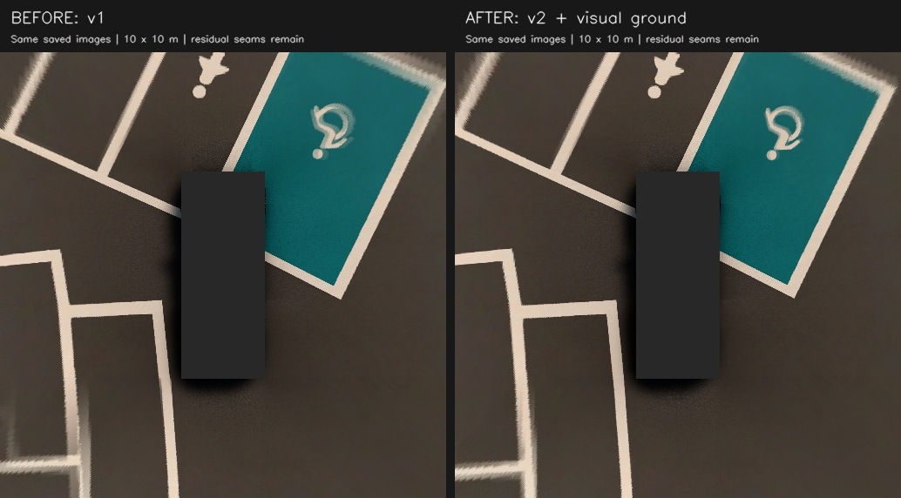

# SVM 보정과 검증

현재 기본값은 **`261112_kcity_ego_ground_v2`**다. MORAI 26.R1.H3 / Ioniq5 / 179°·1280×960 카메라 4개에 적용한다. **차량 자세 변환 오류를 수정하고 렌즈를 다시 추정했으며, 영상 근거가 충분할 때만 주변 지면을 보정한다. 아직 가장자리 오차가 남은 preview다.**

## 이전 보정이 다른 위치에서 어긋난 이유

이전 v1은 카메라 local TF에서 확인한 quaternion x 부호 변환을 ego TF에도 사용했다. 설치된 26.R1.H3의 TF 생성 경로를 다시 확인하니 두 경로의 Euler 조합이 달랐다. 차체 roll/pitch가 생기면 이 차이가 지면 기울기와 카메라 간 정합에 영향을 준다. v1의 카메라 각도 correction도 이 잘못된 자세를 전제로 추정한 값이므로 제거했다.

`morai_26r1_ego_euler`는 원본 quaternion의 회전행렬 S에서 `pitch=asin(S[1,2])`, `roll=atan2(S[0,2],S[2,2])`, `yaw=atan2(S[1,0],S[1,1])`을 얻고 `Rz(yaw) Ry(pitch) Rx(roll)`로 변환한다. quaternion 부호 ±와 여러 기울기·방향을 독립 회전 라이브러리로 검사했다. `/tf`를 수정·재발행하지 않으며 SVM 입력에만 적용한다. 이는 이번 설치 버전의 어댑터다. 일반 ROS는 `ros_xyzw`를 사용한다.

원본 센서 JSON의 위치·각도, 차량 치수, base_link 높이 0.35m와 그림 크기는 유지한다. 공유 렌즈는 `fx=fy=411.1295, cx=638.9412, cy=479.3927`, `D=[-0.00584717, 0.00227055, 0, 0]`이다. 세 위치의 페인트 경계로 K와 k1/k2만 추정했다. 카메라 각도까지 푼 후보는 경계값에 닿고 기존 장면의 결과가 나빠져 채택하지 않았다. 정확한 값은 [svm.yaml](../../src/vip3_perception/config/svm.yaml)에 있다.

## 지면·촬영 시차 처리

- `/tf`의 map → base_link를 영상 시각에 보간하고 가장 늦은 영상의 차량 좌표를 출력 기준으로 사용한다. 각 카메라의 촬영 시차에 따른 회전·이동을 반영한다. TF age 0.5초, 영상과의 허용 차이 50ms를 넘으면 정적 fallback을 사용한다.
- 기본 지면은 map의 수평면과 고정 차고를 가정한다. 페인트 높이 +0.01m를 더해 수평 투영면은 z=−0.34m다. **차체 기울기만으로 실제 도로 경사를 알 수 없으므로** 이 가정만으로 모든 위치를 맞출 수 없다.
- 새 `ground.py`는 1초마다 카메라 겹침 영상의 특징을 양방향 추적하고 광선을 삼각측량한다. 최소 20점·3개 겹침 쌍·공간 분포·높이 잔차를 검사해 로컬 지면 하나를 추정한다. 설치 맵이나 주차칸 GT를 런타임에 읽지 않는다.
- Ioniq5 기준 원점 높이 −0.44~−0.24m, 기울기 크기 <0.08, 지면 fit RMS ≤1.5cm 안에서만 후보를 검토한다. 공통 광선의 정합 개선과 각 겹침 쌍의 악화 여부도 검사한다. 이 내부 채택 기준은 실제 전체 주차선 오차 보증이 아니다.
- 채택한 평면은 world 좌표로 최대 2초·이동 1.5m 안에서 재사용한다. 새 영상이 기존 평면을 계속 지지하면 시간만 갱신한다. TF/영상 중단, 시각 역행, 범위 이탈 때 폐기한다. 영상 지면은 이미 보이는 표면을 추정하므로 페인트 오프셋을 중복 적용하지 않는다.
- 영상 근거가 부족하면 가정 지면으로 돌아간다. 한 평면으로 비평면 노면·벽·기둥을 복원할 수 없다. 카메라 겹침에 평면 특징이 적거나 반복 무늬가 있으면 추정이 실패하거나 오대응할 수 있다.

화면의 `EGO CAL | PREVIEW`는 프로필, `GROUND VISION`은 현재 영상 추정/유지, `GROUND ASSUMED`는 가정 지면을 뜻한다. `POSE USED`는 자세를 적용했다는 표시다. 어느 문구도 정확도 합격을 뜻하지 않는다. `/perception/svm/status`와 `capture.json`의 `ground_refinement`에서 거절 이유·대응점 수·평면을 확인한다. 입력 영상 하나라도 끊기면 valid mask를 0으로 발행한다. 차량 마스크는 관측 불가 영역이며, 주차 가능 영역이나 장애물 검출 결과가 아니다.

## 같은 영상으로 비교한 결과 — 2026-11-12

아래는 **카메라 겹침부 주차선의 법선 방향 절대 차이, 중앙값 / 95백분위(cm)**다. 각 행의 자동 대응점은 후보 간 동일하다. 선 방향 오차나 2D 주차 목표 정확도가 아니며 오대응과 상관된 선 표본이 포함될 수 있다.

| 저장 장면 | 초기 정적 설정 | 이전 v1 | 새 v2 + 영상 지면 |
|---|---:|---:|---:|
| 11/11 정차 01 | 4.14 / 8.46 | 0.88 / 4.25 | 1.71 / 8.01 |
| 11/11 정차 02, 렌즈 추정 제외 | 4.72 / 8.65 | 1.23 / 3.15 | 1.54 / 4.65 |
| 11/12 live 01 | 4.31 / 15.53 | 3.23 / 11.75 | 2.19 / 10.39 |
| 11/12 live 02, 렌즈 추정 제외 | 3.18 / 11.51 | 3.48 / 10.82 | 2.62 / 9.20 |
| 11/12 새 정차 01 | 8.39 / 33.47 | 8.42 / 26.74 | 6.89 / 18.59 |

**새 장면은 개선됐지만 v1이 잘 맞던 11/11 두 장면은 소폭 나빠졌다.** 이 두 장면에서는 영상 지면이 채택되지 않았다. 전체 위치에 대한 보정 완료나 자율주차 정밀도 달성을 주장하지 않는다. 표의 두 제외 장면은 렌즈 최적화 입력에서 제외했지만 후보 비교에 사용했으므로 완전히 독립된 최종 시험은 아니다. 다음 검증은 보정에 쓰지 않은 새 위치·방향·경사와 주행 시퀀스다.



원본 센서 JPEG와 TF를 별도 토픽으로 재생해 실제 ROS 노드의 정상 처리, TF 중단 fallback, 영상 중단 mask 무효화, 시각 리셋 복구를 확인했다. 저장 투영의 재생 픽셀도 동일하다. **11/12 저녁 실제 MORAI 재연결 후 새 프로필·자세·영상 지면 적용과 약 9Hz 출력을 확인했다.** 왼쪽 아래 주차선과 장애인 표식의 잔여 오차는 라이브에서도 보인다. 현재 위치의 보정 적용 확인이며 다른 위치·주행 정확도 합격 판정은 아니다. [라이브 측정과 화면](../notes/261112-svm-live.md).

[측정값·입력 해시·검사 범위](../../src/vip3_perception/config/calibration/261112_validation.json), [팀 작업 노트](../notes/261112-svm-calibration.md), [실행 명령](../commands.md#svm-calibration). 이전 v1 결과는 Git 이력과 날짜가 붙은 기존 evidence JSON에 보존한다. 현행 프로필은 clean BEV/SS-PSD 학습 입력 검증 완료를 뜻하지 않는다.

## 수동 대응점으로 별도 후보 만들기

`tools/svm/calibrate.py`는 공유 focal·k1/k2와 카메라별 작은 각도 오프셋을 추정하는 별도 도구다. 현재 v2의 다중 위치 렌즈 피팅과 영상 지면 추정은 이 도구의 합격 조건을 통과했다는 의미가 아니다. 현행 v2는 위 제한을 표시한 preview로 배포한다.

관측 JSON의 `observations` 배열에는 다음 형식의 점을 넣는다. 숫자는 **형식 예시**이며 실측값으로 바꿔야 한다.

```json
{
  "observations": [
    {
      "point_id": "capture01_corner_A",
      "view": "front",
      "pixel": [640.0, 600.0],
      "ground_xy": [4.5, 0.0],
      "plane": {"z_at_origin_m": -0.35, "dz_dx": 0.0, "dz_dy": 0.0},
      "split": "train"
    }
  ]
}
```

`pixel`은 원본 영상의 `[u,v]`, `ground_xy`와 `plane`은 **그 촬영 시각의 base_link** 기준이다. 실제 페인트 경계/교점을 측정한다. GT 주차칸 폴리곤의 선 중심과 페인트 바깥 모서리를 혼동하지 않는다. GT와 설치 맵의 좌표·버전 일치도 먼저 확인한다. 가능하면 여러 정차 위치에서 수집한다.

카메라마다 2차원으로 분포한 train ≥8점, validation ≥4점이 필요하다. 같은 물리 점의 `point_id`를 양쪽 split에 재사용할 수 없다. soft-L1 손실과 작은 변화 범위를 사용하며 다음 조건을 모두 만족해야 새 YAML을 저장한다.

- optimizer 수렴, 파라미터 제한값 미도달, 렌즈 단조성 유지
- 검증 XY RMSE ≤0.15m 및 초기값 대비 20% 이상 개선
- 네 카메라 각각 검증 RMSE가 나빠지지 않음

이 기준은 **후보 파일 생성 조건**이다. 실제 배포 전에는 다른 차량 위치·각도에서 별도 검증하고 주차 목표 오차에 맞춰 더 엄격한 기준을 정한다. 원본 설정은 도구가 덮어쓰지 않는다. 실패하면 report만 남기고 종료 코드 2를 반환한다. [실행 명령](../commands.md#svm-calibration).
